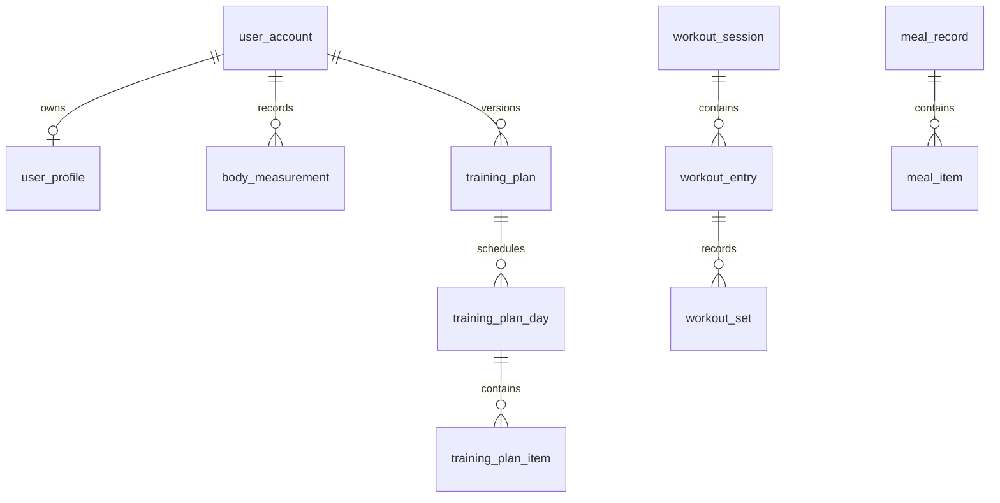
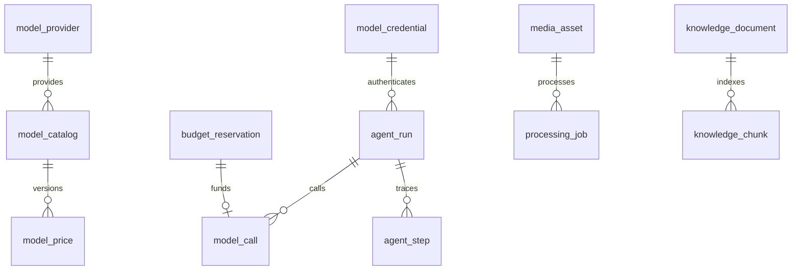

# FitAgent 数据库设计与字段字典

版本：v1.0；日期：2026-10-12。配套脚本：`schema.sql`。目标为 MySQL 8.4，所有时间戳使用 UTC，业务日期另存。

本字典与 SQL 从同一字段模型生成，避免手工写两份发生错位。P1/P2/P3 是开发阶段，完整脚本按外键依赖顺序建表，不代表必须一次开发所有页面。

## 1. 设计约定

- 数值金额使用 DECIMAL；代码使用 BigDecimal；不使用 float/double 保存账本。
- 重量 kg、食物分量 g、身高 cm、时长 s；视频引用 ms；热量 kcal。
- NULL 表示未知或不适用，不把缺失饮食、时长、用量当作 0。
- 业务数据可同步到服务器；“主要保存在手机”指原始图片、视频和资料文件。
- `user_id` 只能来自后端认证上下文；对子资源也校验父资源所属用户。重要私有父子关系采用 `(id,user_id)` 复合外键。
- 文档片段通过父文档判定 SYSTEM/PRIVATE 权限；Qdrant 命中后必须回查 MySQL 的权限、状态和版本。
- 对历史计划、价格、规则保留版本；对可变聚合使用 lock_version。历史调用不随 Key 和价格变化改写。
- 外键默认 RESTRICT。业务删除按依赖顺序处理，资料向量及临时媒体通过 outbox 清理；不对仍需结算的任务直接物理删除。
- 常用字段 `created_at/updated_at` 由数据库记录 UTC 时间；数据修改同时递增 user_account.data_revision，以判断报告是否过期。
- JSON 保存结构化证据和快照；能用于查询和关联的核心字段仍单独建列。JSON 必须校验版本和体积。
- 字段解释里的 enum 值即代码契约。CHECK 仅完成局部约束，跨表业务规则由 Service 事务校验。

## 2. 表清单

| 序号 | 表 | 用途 | 阶段 | 字段数 |
|---|---|---|---|---:|

| 1 | `user_account` | 微信用户与数据修订号 | P1 | 12 |
| 2 | `user_profile` | 身体与训练背景 | P1 | 15 |
| 3 | `user_goal` | 目标历史 | P1 | 13 |
| 4 | `body_measurement` | 身体记录 | P1 | 13 |
| 5 | `daily_checkin` | 每日记录完整性与用户自报恢复信息 | P1 | 11 |
| 6 | `food_reference` | 有来源的食物营养条目 | P1 | 16 |
| 7 | `met_activity` | 运动 MET 来源表 | P1 | 11 |
| 8 | `calculation_rule` | 计算规则版本目录 | P1 | 12 |
| 9 | `exercise_reference` | 训练动作字典 | P1 | 11 |
| 10 | `model_provider` | 供应商目录 | P2 | 9 |
| 11 | `model_catalog` | 模型能力配置 | P2 | 12 |
| 12 | `model_price` | 价格版本与币种 | P2 | 14 |
| 13 | `model_credential` | 用户模型 Key 加密凭据 | P2 | 16 |
| 14 | `provider_balance_snapshot` | 供应商账户余额快照 | P2 | 12 |
| 15 | `budget_policy` | 应用侧费用预算 | P2 | 13 |
| 16 | `budget_daily_usage` | 每日预算并发汇总 | P2 | 11 |
| 17 | `chat_conversation` | 聊天会话 | P2 | 10 |
| 18 | `agent_run` | 一次完整 AI 任务 | P2 | 20 |
| 19 | `budget_reservation` | 逐次模型调用预算预占 | P2 | 12 |
| 20 | `model_call` | 每次付费模型调用与用量 | P2 | 24 |
| 21 | `chat_message` | 聊天消息与工具消息 | P2 | 14 |
| 22 | `agent_step` | 工具执行及运行事件轨迹 | P2 | 15 |
| 23 | `media_asset` | 手机原件与服务器临时媒体元数据 | P1 | 17 |
| 24 | `processing_job` | 可恢复的文件解析任务与结果 | P3 | 24 |
| 25 | `training_plan` | 训练计划不可覆盖的版本 | P1 | 18 |
| 26 | `training_plan_day` | 每周计划日模板 | P1 | 9 |
| 27 | `training_plan_item` | 计划日内训练动作 | P1 | 14 |
| 28 | `workout_session` | 实际训练场次 | P1 | 13 |
| 29 | `workout_entry` | 实际动作及运动消耗输入 | P1 | 15 |
| 30 | `workout_set` | 力量动作的实际逐组记录 | P1 | 10 |
| 31 | `meal_record` | 饮食记录头 | P1 | 13 |
| 32 | `meal_item` | 确认后的食物及营养快照 | P1 | 21 |
| 33 | `knowledge_document` | 系统知识或用户私有解析资料 | P3 | 20 |
| 34 | `knowledge_chunk` | 可引用的知识片段 | P3 | 15 |
| 35 | `analysis_report` | 日报、周报与可重现指标快照 | P2 | 15 |
| 36 | `outbox_event` | 跨 MySQL 与向量索引的最终一致性事件 | P3 | 14 |

## 3. 主要关系





图只显示主要关系，准确外键以下列字典和 SQL 为准。图未画出的用户隔离仍须执行。

## 4. 完整字段字典


### 1. `user_account` — 微信用户与数据修订号

开发阶段：P1。

| 字段 | 类型 | 可空 | 默认或派生 | 含义 |
|---|---|---|---|---|
| `id` | `BIGINT UNSIGNED` | 否 | AUTO_INCREMENT | 主键；API 统一以字符串返回 |
| `wechat_app_id` | `VARCHAR(64)` | 否 | — | 微信小程序 AppID |
| `wechat_open_id` | `VARCHAR(128)` | 否 | — | 后端 code2Session 获取的 openid |
| `wechat_union_id` | `VARCHAR(128)` | 是 | — | 可选 unionid |
| `nickname` | `VARCHAR(80)` | 是 | — | 用户显示名称 |
| `role` | `ENUM('USER','ADMIN')` | 否 | 'USER' | 应用角色 |
| `status` | `ENUM('ACTIVE','DISABLED','DELETION_PENDING')` | 否 | 'ACTIVE' | 账户状态 |
| `timezone` | `VARCHAR(64)` | 否 | 'Asia/Shanghai' | 记录所用业务时区 |
| `data_revision` | `BIGINT UNSIGNED` | 否 | 0 | 饮食、身体、训练等数据变更时事务内递增 |
| `last_login_at` | `DATETIME(3)` | 是 | — | UTC 最近登录时间 |
| `created_at` | `DATETIME(3)` | 否 | CURRENT_TIMESTAMP(3) | UTC 创建时间 |
| `updated_at` | `DATETIME(3)` | 否 | CURRENT_TIMESTAMP(3) | UTC 最后更新时间 |

索引：PRIMARY KEY (id)；UNIQUE KEY (wechat_app_id, wechat_open_id)。


### 2. `user_profile` — 身体与训练背景

开发阶段：P1。

| 字段 | 类型 | 可空 | 默认或派生 | 含义 |
|---|---|---|---|---|
| `id` | `BIGINT UNSIGNED` | 否 | AUTO_INCREMENT | 主键；API 统一以字符串返回 |
| `user_id` | `BIGINT UNSIGNED` | 否 | — | 所属用户；从登录上下文取得 |
| `birth_date` | `DATE` | 是 | — | 可选出生日期；不提供时年龄相关公式不执行 |
| `sex_for_equation` | `ENUM('MALE','FEMALE','UNSPECIFIED')` | 否 | 'UNSPECIFIED' | 公式所需生理性别参数；未指定则不套用性别公式 |
| `height_cm` | `DECIMAL(6,2)` | 是 | — | 身高，cm |
| `training_level` | `ENUM('BEGINNER','INTERMEDIATE','ADVANCED')` | 否 | 'BEGINNER' | 自报训练经验 |
| `activity_category` | `ENUM('LIGHT','MODERATE','VIGOROUS')` | 是 | — | 已确认的长期活动类别；含工作、日常及习惯运动 |
| `activity_confirmed_at` | `DATETIME(3)` | 是 | — | 长期活动类别最近确认时间 |
| `diet_preferences` | `JSON` | 是 | — | 饮食偏好及用户主动提供的限制 |
| `equipment` | `JSON` | 是 | — | 可用器械列表 |
| `training_constraints` | `JSON` | 是 | — | 可用时间和用户主动提供的训练限制 |
| `professional_guidance_required` | `BOOLEAN` | 否 | FALSE | 用户自报需专业指导；不保存诊断推断 |
| `lock_version` | `INT UNSIGNED` | 否 | 0 | 乐观锁版本；更新时比较并递增 |
| `created_at` | `DATETIME(3)` | 否 | CURRENT_TIMESTAMP(3) | UTC 创建时间 |
| `updated_at` | `DATETIME(3)` | 否 | CURRENT_TIMESTAMP(3) | UTC 最后更新时间 |

索引：PRIMARY KEY (id)；UNIQUE KEY (id, user_id)；KEY (user_id)；UNIQUE KEY (user_id)。

CHECK：`height_cm IS NULL OR height_cm > 0`。

外键：

- `(user_id)` → `user_account(id)`；删除 RESTRICT


### 3. `user_goal` — 目标历史

开发阶段：P1。

| 字段 | 类型 | 可空 | 默认或派生 | 含义 |
|---|---|---|---|---|
| `id` | `BIGINT UNSIGNED` | 否 | AUTO_INCREMENT | 主键；API 统一以字符串返回 |
| `user_id` | `BIGINT UNSIGNED` | 否 | — | 所属用户；从登录上下文取得 |
| `goal_type` | `ENUM('FAT_LOSS','MUSCLE_GAIN','MAINTAIN','GENERAL_FITNESS')` | 否 | — | 目标类型 |
| `target_weight_kg` | `DECIMAL(6,2)` | 是 | — | 用户目标体重；kg |
| `daily_intake_target_kcal` | `DECIMAL(9,2)` | 是 | — | 用户确认的饮食目标；不是系统自动处方 |
| `weekly_sessions_target` | `TINYINT UNSIGNED` | 是 | — | 每周目标训练次数 |
| `starts_on` | `DATE` | 否 | — | 目标开始日期 |
| `ends_on` | `DATE` | 是 | — | 可选结束日期 |
| `status` | `ENUM('DRAFT','ACTIVE','ARCHIVED')` | 否 | 'DRAFT' | 目标状态 |
| `active_user_id` | `BIGINT UNSIGNED` | 是 | GENERATED ALWAYS AS (CASE WHEN status = 'ACTIVE' THEN user_id ELSE NULL END) STORED | 数据库派生字段；每用户最多一个 ACTIVE 目标 |
| `lock_version` | `INT UNSIGNED` | 否 | 0 | 乐观锁版本；更新时比较并递增 |
| `created_at` | `DATETIME(3)` | 否 | CURRENT_TIMESTAMP(3) | UTC 创建时间 |
| `updated_at` | `DATETIME(3)` | 否 | CURRENT_TIMESTAMP(3) | UTC 最后更新时间 |

索引：PRIMARY KEY (id)；UNIQUE KEY (id, user_id)；KEY (user_id)；UNIQUE KEY (active_user_id)。

CHECK：`target_weight_kg IS NULL OR target_weight_kg > 0`；`daily_intake_target_kcal IS NULL OR daily_intake_target_kcal > 0`；`ends_on IS NULL OR ends_on >= starts_on`。

外键：

- `(user_id)` → `user_account(id)`；删除 RESTRICT


### 4. `body_measurement` — 身体记录

开发阶段：P1。

| 字段 | 类型 | 可空 | 默认或派生 | 含义 |
|---|---|---|---|---|
| `id` | `BIGINT UNSIGNED` | 否 | AUTO_INCREMENT | 主键；API 统一以字符串返回 |
| `user_id` | `BIGINT UNSIGNED` | 否 | — | 所属用户；从登录上下文取得 |
| `measured_at` | `DATETIME(3)` | 否 | — | UTC 测量时间 |
| `business_date` | `DATE` | 否 | — | 按记录时用户时区确定的业务日期 |
| `weight_kg` | `DECIMAL(6,2)` | 否 | — | 用户实测体重，kg |
| `waist_cm` | `DECIMAL(6,2)` | 是 | — | 可选腰围，cm |
| `body_fat_percent` | `DECIMAL(5,2)` | 是 | — | 可选自报体脂率；不通过照片推算 |
| `source` | `ENUM('MANUAL','IMPORT')` | 否 | 'MANUAL' | 记录来源 |
| `client_record_uuid` | `CHAR(36)` | 否 | — | 客户端去重 UUID |
| `notes` | `VARCHAR(500)` | 是 | — | 备注 |
| `lock_version` | `INT UNSIGNED` | 否 | 0 | 乐观锁版本；更新时比较并递增 |
| `created_at` | `DATETIME(3)` | 否 | CURRENT_TIMESTAMP(3) | UTC 创建时间 |
| `updated_at` | `DATETIME(3)` | 否 | CURRENT_TIMESTAMP(3) | UTC 最后更新时间 |

索引：PRIMARY KEY (id)；UNIQUE KEY (id, user_id)；KEY (user_id)；UNIQUE KEY (user_id, client_record_uuid)；KEY (user_id, business_date, measured_at)。

CHECK：`weight_kg > 0`；`waist_cm IS NULL OR waist_cm > 0`；`body_fat_percent IS NULL OR (body_fat_percent >= 0 AND body_fat_percent <= 100)`。

外键：

- `(user_id)` → `user_account(id)`；删除 RESTRICT


### 5. `daily_checkin` — 每日记录完整性与用户自报恢复信息

开发阶段：P1。

| 字段 | 类型 | 可空 | 默认或派生 | 含义 |
|---|---|---|---|---|
| `id` | `BIGINT UNSIGNED` | 否 | AUTO_INCREMENT | 主键；API 统一以字符串返回 |
| `user_id` | `BIGINT UNSIGNED` | 否 | — | 所属用户；从登录上下文取得 |
| `business_date` | `DATE` | 否 | — | 按用户记录时区确定的业务日期 |
| `intake_log_complete` | `BOOLEAN` | 否 | FALSE | 用户明确确认当天饮食已全部记录；不能从餐次数自动推断 |
| `workout_log_complete` | `BOOLEAN` | 否 | FALSE | 用户明确确认当天训练已记录完整 |
| `sleep_hours` | `DECIMAL(4,2)` | 是 | — | 可选自报睡眠小时数 |
| `recovery_note` | `VARCHAR(500)` | 是 | — | 可选恢复与疲劳感受 |
| `completed_at` | `DATETIME(3)` | 是 | — | 最近确认记录完整性的 UTC 时间 |
| `lock_version` | `INT UNSIGNED` | 否 | 0 | 乐观锁版本；更新时比较并递增 |
| `created_at` | `DATETIME(3)` | 否 | CURRENT_TIMESTAMP(3) | UTC 创建时间 |
| `updated_at` | `DATETIME(3)` | 否 | CURRENT_TIMESTAMP(3) | UTC 最后更新时间 |

索引：PRIMARY KEY (id)；UNIQUE KEY (id, user_id)；KEY (user_id)；UNIQUE KEY (user_id, business_date)。

CHECK：`sleep_hours IS NULL OR (sleep_hours >= 0 AND sleep_hours <= 24)`。

外键：

- `(user_id)` → `user_account(id)`；删除 RESTRICT


### 6. `food_reference` — 有来源的食物营养条目

开发阶段：P1。

| 字段 | 类型 | 可空 | 默认或派生 | 含义 |
|---|---|---|---|---|
| `id` | `BIGINT UNSIGNED` | 否 | AUTO_INCREMENT | 主键；API 统一以字符串返回 |
| `food_code` | `VARCHAR(80)` | 否 | — | 内部唯一食物代码 |
| `name` | `VARCHAR(160)` | 否 | — | 食物名称 |
| `aliases` | `JSON` | 是 | — | 别名及匹配关键词 |
| `preparation` | `VARCHAR(160)` | 否 | — | 生熟状态、烹饪方式与可食部说明 |
| `energy_kcal_per_100g` | `DECIMAL(9,3)` | 否 | — | 每 100g 可食部热量，kcal |
| `protein_g_per_100g` | `DECIMAL(7,3)` | 是 | — | 每 100g 蛋白质，g |
| `fat_g_per_100g` | `DECIMAL(7,3)` | 是 | — | 每 100g 脂肪，g |
| `carb_g_per_100g` | `DECIMAL(7,3)` | 是 | — | 每 100g 碳水，g |
| `source_name` | `VARCHAR(200)` | 否 | — | 营养标签或数据源名称 |
| `source_url` | `VARCHAR(1000)` | 是 | — | 来源链接 |
| `source_record_code` | `VARCHAR(100)` | 是 | — | 源数据 ID |
| `source_version` | `VARCHAR(80)` | 否 | — | 数据版本或核查日期 |
| `status` | `ENUM('ACTIVE','DISABLED')` | 否 | 'ACTIVE' | 条目状态 |
| `created_at` | `DATETIME(3)` | 否 | CURRENT_TIMESTAMP(3) | UTC 创建时间 |
| `updated_at` | `DATETIME(3)` | 否 | CURRENT_TIMESTAMP(3) | UTC 最后更新时间 |

索引：PRIMARY KEY (id)；UNIQUE KEY (food_code)；KEY (name)。

CHECK：`energy_kcal_per_100g >= 0`；`protein_g_per_100g IS NULL OR protein_g_per_100g >= 0`；`fat_g_per_100g IS NULL OR fat_g_per_100g >= 0`；`carb_g_per_100g IS NULL OR carb_g_per_100g >= 0`。


### 7. `met_activity` — 运动 MET 来源表

开发阶段：P1。

| 字段 | 类型 | 可空 | 默认或派生 | 含义 |
|---|---|---|---|---|
| `id` | `BIGINT UNSIGNED` | 否 | AUTO_INCREMENT | 主键；API 统一以字符串返回 |
| `activity_code` | `VARCHAR(16)` | 否 | — | 源运动代码 |
| `description` | `VARCHAR(300)` | 否 | — | 活动及强度描述 |
| `met_value` | `DECIMAL(6,2)` | 否 | — | 来源公布的标准 MET 值 |
| `population` | `VARCHAR(80)` | 否 | — | 适用人群，如 ADULT_19_59 |
| `source_name` | `VARCHAR(160)` | 否 | — | 来源名称 |
| `source_version` | `VARCHAR(80)` | 否 | — | 来源版本 |
| `source_url` | `VARCHAR(1000)` | 否 | — | 可追溯来源 |
| `status` | `ENUM('ACTIVE','DISABLED')` | 否 | 'ACTIVE' | 条目状态 |
| `created_at` | `DATETIME(3)` | 否 | CURRENT_TIMESTAMP(3) | UTC 创建时间 |
| `updated_at` | `DATETIME(3)` | 否 | CURRENT_TIMESTAMP(3) | UTC 最后更新时间 |

索引：PRIMARY KEY (id)；UNIQUE KEY (activity_code, source_version)。

CHECK：`met_value > 0`。


### 8. `calculation_rule` — 计算规则版本目录

开发阶段：P1。

| 字段 | 类型 | 可空 | 默认或派生 | 含义 |
|---|---|---|---|---|
| `id` | `BIGINT UNSIGNED` | 否 | AUTO_INCREMENT | 主键；API 统一以字符串返回 |
| `rule_code` | `VARCHAR(64)` | 否 | — | 规则标识 |
| `rule_version` | `VARCHAR(32)` | 否 | — | 不可原地覆盖的规则版本 |
| `display_name` | `VARCHAR(160)` | 否 | — | 规则名称 |
| `rule_kind` | `ENUM('SOURCE_FORMULA','ENGINEERING_METRIC')` | 否 | — | 来源公式或项目定义指标 |
| `expression_text` | `TEXT` | 否 | — | 公式说明；不可 eval 执行 |
| `parameters` | `JSON` | 否 | — | 单位、系数、适用范围和缺失值策略 |
| `source_urls` | `JSON` | 否 | — | 来源链接数组；工程指标可为空数组 |
| `source_checked_on` | `DATE` | 否 | — | 来源核查日期 |
| `status` | `ENUM('ACTIVE','RETIRED')` | 否 | 'ACTIVE' | 版本状态 |
| `created_at` | `DATETIME(3)` | 否 | CURRENT_TIMESTAMP(3) | UTC 创建时间 |
| `updated_at` | `DATETIME(3)` | 否 | CURRENT_TIMESTAMP(3) | UTC 最后更新时间 |

索引：PRIMARY KEY (id)；UNIQUE KEY (rule_code, rule_version)。


### 9. `exercise_reference` — 训练动作字典

开发阶段：P1。

| 字段 | 类型 | 可空 | 默认或派生 | 含义 |
|---|---|---|---|---|
| `id` | `BIGINT UNSIGNED` | 否 | AUTO_INCREMENT | 主键；API 统一以字符串返回 |
| `exercise_code` | `VARCHAR(64)` | 否 | — | 动作唯一代码 |
| `name` | `VARCHAR(120)` | 否 | — | 动作名称 |
| `category` | `ENUM('STRENGTH','CARDIO','MOBILITY')` | 否 | — | 动作类型 |
| `muscle_groups` | `JSON` | 是 | — | 相关肌群 |
| `equipment` | `JSON` | 是 | — | 所需器械 |
| `instructions` | `TEXT` | 是 | — | 经维护的基础操作说明 |
| `source_url` | `VARCHAR(1000)` | 是 | — | 说明来源 |
| `status` | `ENUM('ACTIVE','DISABLED')` | 否 | 'ACTIVE' | 状态 |
| `created_at` | `DATETIME(3)` | 否 | CURRENT_TIMESTAMP(3) | UTC 创建时间 |
| `updated_at` | `DATETIME(3)` | 否 | CURRENT_TIMESTAMP(3) | UTC 最后更新时间 |

索引：PRIMARY KEY (id)；UNIQUE KEY (exercise_code)。


### 10. `model_provider` — 供应商目录

开发阶段：P2。

| 字段 | 类型 | 可空 | 默认或派生 | 含义 |
|---|---|---|---|---|
| `id` | `BIGINT UNSIGNED` | 否 | AUTO_INCREMENT | 主键；API 统一以字符串返回 |
| `provider_code` | `VARCHAR(40)` | 否 | — | 供应商唯一代码 |
| `display_name` | `VARCHAR(100)` | 否 | — | 显示名称 |
| `base_url` | `VARCHAR(500)` | 否 | — | 后端白名单地址；不接受模型或用户传入任意地址 |
| `balance_supported` | `BOOLEAN` | 否 | FALSE | 适配器是否支持官方余额接口 |
| `adapter_code` | `VARCHAR(80)` | 否 | — | 注册的 Java 适配器 ID |
| `status` | `ENUM('ACTIVE','DISABLED')` | 否 | 'ACTIVE' | 供应商状态 |
| `created_at` | `DATETIME(3)` | 否 | CURRENT_TIMESTAMP(3) | UTC 创建时间 |
| `updated_at` | `DATETIME(3)` | 否 | CURRENT_TIMESTAMP(3) | UTC 最后更新时间 |

索引：PRIMARY KEY (id)；UNIQUE KEY (provider_code)。


### 11. `model_catalog` — 模型能力配置

开发阶段：P2。

| 字段 | 类型 | 可空 | 默认或派生 | 含义 |
|---|---|---|---|---|
| `id` | `BIGINT UNSIGNED` | 否 | AUTO_INCREMENT | 主键；API 统一以字符串返回 |
| `provider_id` | `BIGINT UNSIGNED` | 否 | — | 供应商 |
| `model_code` | `VARCHAR(100)` | 否 | — | 官方调用模型名 |
| `display_name` | `VARCHAR(120)` | 否 | — | 显示名 |
| `supports_vision` | `BOOLEAN` | 否 | FALSE | 是否支持图片 |
| `supports_tools` | `BOOLEAN` | 否 | FALSE | 是否支持工具调用 |
| `supports_json` | `BOOLEAN` | 否 | FALSE | 是否支持 JSON 模式 |
| `capability_snapshot` | `JSON` | 否 | — | 接口形状及能力核查元数据 |
| `source_checked_on` | `DATE` | 否 | — | 能力核查日期 |
| `status` | `ENUM('ACTIVE','DISABLED')` | 否 | 'ACTIVE' | 模型状态 |
| `created_at` | `DATETIME(3)` | 否 | CURRENT_TIMESTAMP(3) | UTC 创建时间 |
| `updated_at` | `DATETIME(3)` | 否 | CURRENT_TIMESTAMP(3) | UTC 最后更新时间 |

索引：PRIMARY KEY (id)；UNIQUE KEY (provider_id, model_code)。

外键：

- `(provider_id)` → `model_provider(id)`；删除 RESTRICT


### 12. `model_price` — 价格版本与币种

开发阶段：P2。

| 字段 | 类型 | 可空 | 默认或派生 | 含义 |
|---|---|---|---|---|
| `id` | `BIGINT UNSIGNED` | 否 | AUTO_INCREMENT | 主键；API 统一以字符串返回 |
| `model_id` | `BIGINT UNSIGNED` | 否 | — | 模型 |
| `price_version` | `VARCHAR(64)` | 否 | — | 应用价格版本；历史调用引用不可覆盖 |
| `currency` | `CHAR(3)` | 否 | — | 原生报价币种，如 CNY、USD |
| `rate_tier` | `ENUM('PEAK','OFF_PEAK')` | 否 | — | 对应价格档位 |
| `input_hit_per_million` | `DECIMAL(20,10)` | 否 | — | 每百万缓存命中输入 Token 价格 |
| `input_miss_per_million` | `DECIMAL(20,10)` | 否 | — | 每百万未命中输入 Token 价格 |
| `output_per_million` | `DECIMAL(20,10)` | 否 | — | 每百万输出 Token 价格 |
| `schedule_policy` | `JSON` | 否 | — | 档位判断规则、时区和节假日核查状态 |
| `source_url` | `VARCHAR(1000)` | 否 | — | 官方价格来源 |
| `source_checked_on` | `DATE` | 否 | — | 核查日期 |
| `enabled` | `BOOLEAN` | 否 | TRUE | 可供应用核算；上线前应重新核对 |
| `created_at` | `DATETIME(3)` | 否 | CURRENT_TIMESTAMP(3) | UTC 创建时间 |
| `updated_at` | `DATETIME(3)` | 否 | CURRENT_TIMESTAMP(3) | UTC 最后更新时间 |

索引：PRIMARY KEY (id)；UNIQUE KEY (model_id, price_version, currency, rate_tier)。

CHECK：`input_hit_per_million >= 0`；`input_miss_per_million >= 0`；`output_per_million >= 0`。

外键：

- `(model_id)` → `model_catalog(id)`；删除 RESTRICT


### 13. `model_credential` — 用户模型 Key 加密凭据

开发阶段：P2。

| 字段 | 类型 | 可空 | 默认或派生 | 含义 |
|---|---|---|---|---|
| `id` | `BIGINT UNSIGNED` | 否 | AUTO_INCREMENT | 主键；API 统一以字符串返回 |
| `user_id` | `BIGINT UNSIGNED` | 否 | — | 所属用户；从登录上下文取得 |
| `provider_id` | `BIGINT UNSIGNED` | 否 | — | 供应商 |
| `label` | `VARCHAR(80)` | 否 | — | 凭据别名 |
| `key_suffix` | `VARCHAR(8)` | 否 | — | 只允许展示的尾部片段 |
| `key_fingerprint` | `BINARY(32)` | 否 | — | 服务端 HMAC 指纹；不用可逆明文做去重 |
| `ciphertext` | `BLOB` | 是 | — | AES-GCM 密文及认证标签；撤销后清除，不得返回前端 |
| `nonce` | `BINARY(12)` | 是 | — | 每次加密生成的新随机 nonce；撤销后可清除 |
| `encryption_key_version` | `VARCHAR(40)` | 否 | — | 主加密密钥版本；主密钥不入库 |
| `credential_version` | `INT UNSIGNED` | 否 | 1 | 换 Key 时递增；账本保存当时版本 |
| `status` | `ENUM('ACTIVE','INVALID','REVOKED')` | 否 | 'ACTIVE' | 凭据状态 |
| `validated_at` | `DATETIME(3)` | 是 | — | 最近验证成功时间 |
| `revoked_at` | `DATETIME(3)` | 是 | — | 撤销时间 |
| `lock_version` | `INT UNSIGNED` | 否 | 0 | 乐观锁版本；更新时比较并递增 |
| `created_at` | `DATETIME(3)` | 否 | CURRENT_TIMESTAMP(3) | UTC 创建时间 |
| `updated_at` | `DATETIME(3)` | 否 | CURRENT_TIMESTAMP(3) | UTC 最后更新时间 |

索引：PRIMARY KEY (id)；UNIQUE KEY (id, user_id)；KEY (user_id)；UNIQUE KEY (user_id, provider_id)。

CHECK：`status <> 'ACTIVE' OR (ciphertext IS NOT NULL AND nonce IS NOT NULL)`。

外键：

- `(provider_id)` → `model_provider(id)`；删除 RESTRICT
- `(user_id)` → `user_account(id)`；删除 RESTRICT


### 14. `provider_balance_snapshot` — 供应商账户余额快照

开发阶段：P2。

| 字段 | 类型 | 可空 | 默认或派生 | 含义 |
|---|---|---|---|---|
| `id` | `BIGINT UNSIGNED` | 否 | AUTO_INCREMENT | 主键；API 统一以字符串返回 |
| `user_id` | `BIGINT UNSIGNED` | 否 | — | 所属用户；从登录上下文取得 |
| `credential_id` | `BIGINT UNSIGNED` | 否 | — | 使用的凭据 |
| `credential_version` | `INT UNSIGNED` | 否 | — | 当时凭据版本 |
| `currency` | `CHAR(3)` | 否 | — | 官方返回币种 |
| `total_balance` | `DECIMAL(20,10)` | 否 | — | 官方账户总可用余额 |
| `granted_balance` | `DECIMAL(20,10)` | 否 | — | 官方赠金 |
| `topped_up_balance` | `DECIMAL(20,10)` | 否 | — | 官方充值余额 |
| `is_available` | `BOOLEAN` | 否 | — | 官方返回是否可调用 |
| `fetched_at` | `DATETIME(3)` | 否 | — | UTC 查询成功时间 |
| `created_at` | `DATETIME(3)` | 否 | CURRENT_TIMESTAMP(3) | UTC 创建时间 |
| `updated_at` | `DATETIME(3)` | 否 | CURRENT_TIMESTAMP(3) | UTC 最后更新时间 |

索引：PRIMARY KEY (id)；UNIQUE KEY (id, user_id)；KEY (user_id)；KEY (user_id, credential_id, currency, fetched_at)。

外键：

- `(credential_id, user_id)` → `model_credential(id, user_id)`；删除 RESTRICT
- `(user_id)` → `user_account(id)`；删除 RESTRICT


### 15. `budget_policy` — 应用侧费用预算

开发阶段：P2。

| 字段 | 类型 | 可空 | 默认或派生 | 含义 |
|---|---|---|---|---|
| `id` | `BIGINT UNSIGNED` | 否 | AUTO_INCREMENT | 主键；API 统一以字符串返回 |
| `user_id` | `BIGINT UNSIGNED` | 否 | — | 所属用户；从登录上下文取得 |
| `provider_id` | `BIGINT UNSIGNED` | 否 | — | 供应商 |
| `currency` | `CHAR(3)` | 否 | — | 预算币种；必须与价格核算币种一致 |
| `max_task_cost` | `DECIMAL(20,10)` | 是 | — | 单次完整任务预算；NULL 未设限 |
| `max_daily_cost` | `DECIMAL(20,10)` | 是 | — | 本应用每日预算；NULL 未设限 |
| `budget_timezone` | `VARCHAR(64)` | 否 | 'Asia/Shanghai' | 首版固定 Asia/Shanghai，避免移动时区绕过预算 |
| `max_agent_rounds` | `TINYINT UNSIGNED` | 否 | 6 | 工具循环轮数上限 |
| `max_output_tokens` | `INT UNSIGNED` | 否 | 2048 | 每次请求输出上限；平台另有硬上限 |
| `enabled` | `BOOLEAN` | 否 | TRUE | 是否启用配置的费用预算 |
| `lock_version` | `INT UNSIGNED` | 否 | 0 | 乐观锁版本；更新时比较并递增 |
| `created_at` | `DATETIME(3)` | 否 | CURRENT_TIMESTAMP(3) | UTC 创建时间 |
| `updated_at` | `DATETIME(3)` | 否 | CURRENT_TIMESTAMP(3) | UTC 最后更新时间 |

索引：PRIMARY KEY (id)；UNIQUE KEY (id, user_id)；KEY (user_id)；UNIQUE KEY (user_id, provider_id, currency)。

CHECK：`max_task_cost IS NULL OR max_task_cost > 0`；`max_daily_cost IS NULL OR max_daily_cost > 0`；`max_agent_rounds > 0`；`max_output_tokens > 0`。

外键：

- `(provider_id)` → `model_provider(id)`；删除 RESTRICT
- `(user_id)` → `user_account(id)`；删除 RESTRICT


### 16. `budget_daily_usage` — 每日预算并发汇总

开发阶段：P2。

| 字段 | 类型 | 可空 | 默认或派生 | 含义 |
|---|---|---|---|---|
| `id` | `BIGINT UNSIGNED` | 否 | AUTO_INCREMENT | 主键；API 统一以字符串返回 |
| `user_id` | `BIGINT UNSIGNED` | 否 | — | 所属用户；从登录上下文取得 |
| `provider_id` | `BIGINT UNSIGNED` | 否 | — | 供应商 |
| `currency` | `CHAR(3)` | 否 | — | 同币种累计 |
| `budget_date` | `DATE` | 否 | — | Asia/Shanghai 预算日；按每次调用开始时间归属 |
| `settled_cost` | `DECIMAL(20,10)` | 否 | 0 | 已收到用量、按价格表核算的费用 |
| `reserved_cost` | `DECIMAL(20,10)` | 否 | 0 | 正在执行调用的预占金额 |
| `uncertain_reserved_cost` | `DECIMAL(20,10)` | 否 | 0 | 结果不明调用仍保留的预占金额 |
| `lock_version` | `INT UNSIGNED` | 否 | 0 | 乐观锁版本；更新时比较并递增 |
| `created_at` | `DATETIME(3)` | 否 | CURRENT_TIMESTAMP(3) | UTC 创建时间 |
| `updated_at` | `DATETIME(3)` | 否 | CURRENT_TIMESTAMP(3) | UTC 最后更新时间 |

索引：PRIMARY KEY (id)；UNIQUE KEY (id, user_id)；KEY (user_id)；UNIQUE KEY (user_id, provider_id, currency, budget_date)。

CHECK：`settled_cost >= 0`；`reserved_cost >= 0`；`uncertain_reserved_cost >= 0`。

外键：

- `(provider_id)` → `model_provider(id)`；删除 RESTRICT
- `(user_id)` → `user_account(id)`；删除 RESTRICT


### 17. `chat_conversation` — 聊天会话

开发阶段：P2。

| 字段 | 类型 | 可空 | 默认或派生 | 含义 |
|---|---|---|---|---|
| `id` | `BIGINT UNSIGNED` | 否 | AUTO_INCREMENT | 主键；API 统一以字符串返回 |
| `user_id` | `BIGINT UNSIGNED` | 否 | — | 所属用户；从登录上下文取得 |
| `title` | `VARCHAR(160)` | 否 | — | 会话标题 |
| `summary_text` | `TEXT` | 是 | — | 可选历史摘要；仅保存必要事实 |
| `summary_through_message_id` | `BIGINT UNSIGNED` | 是 | — | 摘要覆盖到的消息 ID；不是跨租户引用 |
| `status` | `ENUM('ACTIVE','ARCHIVED')` | 否 | 'ACTIVE' | 状态 |
| `last_message_at` | `DATETIME(3)` | 是 | — | UTC 最近消息时间 |
| `lock_version` | `INT UNSIGNED` | 否 | 0 | 乐观锁版本；更新时比较并递增 |
| `created_at` | `DATETIME(3)` | 否 | CURRENT_TIMESTAMP(3) | UTC 创建时间 |
| `updated_at` | `DATETIME(3)` | 否 | CURRENT_TIMESTAMP(3) | UTC 最后更新时间 |

索引：PRIMARY KEY (id)；UNIQUE KEY (id, user_id)；KEY (user_id)；KEY (user_id, last_message_at)。

外键：

- `(user_id)` → `user_account(id)`；删除 RESTRICT


### 18. `agent_run` — 一次完整 AI 任务

开发阶段：P2。

| 字段 | 类型 | 可空 | 默认或派生 | 含义 |
|---|---|---|---|---|
| `id` | `BIGINT UNSIGNED` | 否 | AUTO_INCREMENT | 主键；API 统一以字符串返回 |
| `user_id` | `BIGINT UNSIGNED` | 否 | — | 所属用户；从登录上下文取得 |
| `run_uuid` | `CHAR(36)` | 否 | — | 对外任务 UUID |
| `conversation_id` | `BIGINT UNSIGNED` | 是 | — | 聊天会话；固定工作流可为空 |
| `credential_id` | `BIGINT UNSIGNED` | 否 | — | 绑定当前用户有效凭据 |
| `task_type` | `ENUM('COACH_CHAT','FOOD_RECOGNITION','PLAN_GENERATE','PLAN_IMPORT','DOCUMENT_PARSE','VIDEO_GUIDE','REPORT')` | 否 | — | 任务种类 |
| `idempotency_key` | `VARCHAR(100)` | 否 | — | 客户端请求去重键 |
| `status` | `ENUM('QUEUED','RUNNING','SUCCEEDED','FAILED','CANCELLED','BUDGET_STOPPED','UNKNOWN','WAITING_CREDENTIAL')` | 否 | 'QUEUED' | 任务状态 |
| `currency` | `CHAR(3)` | 否 | — | 本次核算币种 |
| `estimated_cost` | `DECIMAL(20,10)` | 是 | — | 发送前展示的整次任务估算 |
| `settled_cost` | `DECIMAL(20,10)` | 否 | 0 | 已知调用费用之和 |
| `uncertain_cost` | `BOOLEAN` | 否 | FALSE | 是否存在缺失用量或档位不明调用 |
| `budget_snapshot` | `JSON` | 否 | — | 启动时预算与调用限制快照 |
| `context_revision` | `BIGINT UNSIGNED` | 否 | — | 启动时用户数据修订号 |
| `started_at` | `DATETIME(3)` | 是 | — | UTC 开始时间 |
| `finished_at` | `DATETIME(3)` | 是 | — | UTC 结束时间 |
| `error_code` | `VARCHAR(64)` | 是 | — | 脱敏错误码 |
| `lock_version` | `INT UNSIGNED` | 否 | 0 | 乐观锁版本；更新时比较并递增 |
| `created_at` | `DATETIME(3)` | 否 | CURRENT_TIMESTAMP(3) | UTC 创建时间 |
| `updated_at` | `DATETIME(3)` | 否 | CURRENT_TIMESTAMP(3) | UTC 最后更新时间 |

索引：PRIMARY KEY (id)；UNIQUE KEY (id, user_id)；KEY (user_id)；UNIQUE KEY (run_uuid)；UNIQUE KEY (user_id, idempotency_key)；KEY (user_id, created_at)。

CHECK：`estimated_cost IS NULL OR estimated_cost >= 0`；`settled_cost >= 0`。

外键：

- `(conversation_id, user_id)` → `chat_conversation(id, user_id)`；删除 RESTRICT
- `(credential_id, user_id)` → `model_credential(id, user_id)`；删除 RESTRICT
- `(user_id)` → `user_account(id)`；删除 RESTRICT


### 19. `budget_reservation` — 逐次模型调用预算预占

开发阶段：P2。

| 字段 | 类型 | 可空 | 默认或派生 | 含义 |
|---|---|---|---|---|
| `id` | `BIGINT UNSIGNED` | 否 | AUTO_INCREMENT | 主键；API 统一以字符串返回 |
| `user_id` | `BIGINT UNSIGNED` | 否 | — | 所属用户；从登录上下文取得 |
| `run_id` | `BIGINT UNSIGNED` | 否 | — | 完整任务 |
| `daily_usage_id` | `BIGINT UNSIGNED` | 否 | — | 对应调用开始日的预算汇总 |
| `attempt_no` | `INT UNSIGNED` | 否 | — | 本任务唯一调用尝试序号 |
| `reserved_amount` | `DECIMAL(20,10)` | 否 | — | 本次请求预占金额 |
| `settled_amount` | `DECIMAL(20,10)` | 是 | — | 收到用量后的核算金额 |
| `estimate_quality` | `ENUM('TOKENIZER','CONSERVATIVE_ESTIMATE')` | 否 | — | 输入 Token 估计方法；两者都不代表供应商账单保证 |
| `status` | `ENUM('HELD','SETTLED','RELEASED','UNKNOWN_HELD')` | 否 | 'HELD' | 预占状态 |
| `settled_at` | `DATETIME(3)` | 是 | — | 结算时间 |
| `created_at` | `DATETIME(3)` | 否 | CURRENT_TIMESTAMP(3) | UTC 创建时间 |
| `updated_at` | `DATETIME(3)` | 否 | CURRENT_TIMESTAMP(3) | UTC 最后更新时间 |

索引：PRIMARY KEY (id)；UNIQUE KEY (id, user_id)；KEY (user_id)；UNIQUE KEY (run_id, attempt_no)。

CHECK：`reserved_amount >= 0`；`settled_amount IS NULL OR settled_amount >= 0`。

外键：

- `(run_id, user_id)` → `agent_run(id, user_id)`；删除 RESTRICT
- `(daily_usage_id, user_id)` → `budget_daily_usage(id, user_id)`；删除 RESTRICT
- `(user_id)` → `user_account(id)`；删除 RESTRICT


### 20. `model_call` — 每次付费模型调用与用量

开发阶段：P2。

| 字段 | 类型 | 可空 | 默认或派生 | 含义 |
|---|---|---|---|---|
| `id` | `BIGINT UNSIGNED` | 否 | AUTO_INCREMENT | 主键；API 统一以字符串返回 |
| `user_id` | `BIGINT UNSIGNED` | 否 | — | 所属用户；从登录上下文取得 |
| `run_id` | `BIGINT UNSIGNED` | 否 | — | 所属完整任务 |
| `reservation_id` | `BIGINT UNSIGNED` | 否 | — | 对应预算预占 |
| `model_id` | `BIGINT UNSIGNED` | 否 | — | 模型 |
| `price_id` | `BIGINT UNSIGNED` | 否 | — | 当时采用的原生币种价格版本 |
| `credential_version` | `INT UNSIGNED` | 否 | — | 当时的 Key 版本 |
| `attempt_no` | `INT UNSIGNED` | 否 | — | 任务内唯一调用尝试序号 |
| `provider_request_id` | `VARCHAR(160)` | 是 | — | 供应商返回请求 ID |
| `status` | `ENUM('PREPARED','SENT','SUCCEEDED','FAILED_BEFORE_SEND','REJECTED','UNKNOWN')` | 否 | 'PREPARED' | 调用状态 |
| `input_hit_tokens` | `BIGINT UNSIGNED` | 是 | — | 官方缓存命中输入 Token；NULL 未收到用量 |
| `input_miss_tokens` | `BIGINT UNSIGNED` | 是 | — | 官方未命中输入 Token |
| `output_tokens` | `BIGINT UNSIGNED` | 是 | — | 官方 completion_tokens；包含按官方口径计费的输出 |
| `reasoning_tokens` | `BIGINT UNSIGNED` | 是 | — | 输出中的推理 Token 子项；不重复计费 |
| `usage_payload` | `JSON` | 是 | — | 供应商用量原始对象；不含 Key、原始图片或请求头 |
| `currency` | `CHAR(3)` | 否 | — | 价格币种 |
| `calculated_cost` | `DECIMAL(20,10)` | 是 | — | 按用量和价格核算金额；未知时 NULL |
| `price_confidence` | `ENUM('KNOWN_TIER','CONSERVATIVE_TIER','UNKNOWN')` | 否 | 'UNKNOWN' | 价格档位确定程度 |
| `sent_at` | `DATETIME(3)` | 是 | — | UTC 发出时间，决定预算日 |
| `finished_at` | `DATETIME(3)` | 是 | — | UTC 结束时间 |
| `latency_ms` | `INT UNSIGNED` | 是 | — | 调用耗时 |
| `error_code` | `VARCHAR(64)` | 是 | — | 脱敏错误码 |
| `created_at` | `DATETIME(3)` | 否 | CURRENT_TIMESTAMP(3) | UTC 创建时间 |
| `updated_at` | `DATETIME(3)` | 否 | CURRENT_TIMESTAMP(3) | UTC 最后更新时间 |

索引：PRIMARY KEY (id)；UNIQUE KEY (id, user_id)；KEY (user_id)；UNIQUE KEY (reservation_id)；UNIQUE KEY (run_id, attempt_no)；KEY (user_id, sent_at)。

CHECK：`calculated_cost IS NULL OR calculated_cost >= 0`。

外键：

- `(run_id, user_id)` → `agent_run(id, user_id)`；删除 RESTRICT
- `(reservation_id, user_id)` → `budget_reservation(id, user_id)`；删除 RESTRICT
- `(model_id)` → `model_catalog(id)`；删除 RESTRICT
- `(price_id)` → `model_price(id)`；删除 RESTRICT
- `(user_id)` → `user_account(id)`；删除 RESTRICT


### 21. `chat_message` — 聊天消息与工具消息

开发阶段：P2。

| 字段 | 类型 | 可空 | 默认或派生 | 含义 |
|---|---|---|---|---|
| `id` | `BIGINT UNSIGNED` | 否 | AUTO_INCREMENT | 主键；API 统一以字符串返回 |
| `user_id` | `BIGINT UNSIGNED` | 否 | — | 所属用户；从登录上下文取得 |
| `conversation_id` | `BIGINT UNSIGNED` | 否 | — | 所属会话 |
| `run_id` | `BIGINT UNSIGNED` | 是 | — | 所属任务 |
| `message_no` | `INT UNSIGNED` | 否 | — | 会话内顺序；在会话行锁保护下分配 |
| `role` | `ENUM('USER','ASSISTANT','TOOL')` | 否 | — | 消息角色 |
| `content_text` | `LONGTEXT` | 是 | — | 完整组装后的文本；不保存隐藏推理过程 |
| `tool_call_id` | `VARCHAR(120)` | 是 | — | 工具响应对应 ID |
| `tool_calls` | `JSON` | 是 | — | assistant 工具调用声明；参数脱敏 |
| `attachment_refs` | `JSON` | 是 | — | 当前用户媒体逻辑 ID 数组；不保存 base64 内容 |
| `citations` | `JSON` | 是 | — | 可验证的文档、段落和时间点引用 |
| `status` | `ENUM('PENDING','COMPLETE','FAILED','CANCELLED')` | 否 | 'PENDING' | 消息状态 |
| `created_at` | `DATETIME(3)` | 否 | CURRENT_TIMESTAMP(3) | UTC 创建时间 |
| `updated_at` | `DATETIME(3)` | 否 | CURRENT_TIMESTAMP(3) | UTC 最后更新时间 |

索引：PRIMARY KEY (id)；UNIQUE KEY (id, user_id)；KEY (user_id)；UNIQUE KEY (conversation_id, message_no)。

外键：

- `(conversation_id, user_id)` → `chat_conversation(id, user_id)`；删除 RESTRICT
- `(run_id, user_id)` → `agent_run(id, user_id)`；删除 RESTRICT
- `(user_id)` → `user_account(id)`；删除 RESTRICT


### 22. `agent_step` — 工具执行及运行事件轨迹

开发阶段：P2。

| 字段 | 类型 | 可空 | 默认或派生 | 含义 |
|---|---|---|---|---|
| `id` | `BIGINT UNSIGNED` | 否 | AUTO_INCREMENT | 主键；API 统一以字符串返回 |
| `user_id` | `BIGINT UNSIGNED` | 否 | — | 所属用户；从登录上下文取得 |
| `run_id` | `BIGINT UNSIGNED` | 否 | — | 所属任务 |
| `model_call_id` | `BIGINT UNSIGNED` | 是 | — | 触发该事件的模型调用 |
| `step_no` | `INT UNSIGNED` | 否 | — | 任务内事件序号 |
| `event_type` | `ENUM('TOOL','VALIDATION','CONTEXT','FINALIZATION','ERROR')` | 否 | — | 运行事件类型 |
| `tool_name` | `VARCHAR(100)` | 是 | — | 已注册工具名 |
| `tool_call_id` | `VARCHAR(120)` | 是 | — | 模型工具调用 ID |
| `arguments_redacted` | `JSON` | 是 | — | 通过校验后的脱敏参数 |
| `result_summary` | `JSON` | 是 | — | 限长结果摘要与证据引用 |
| `status` | `ENUM('STARTED','SUCCEEDED','FAILED','SKIPPED')` | 否 | — | 事件状态 |
| `duration_ms` | `INT UNSIGNED` | 是 | — | 耗时 |
| `error_code` | `VARCHAR(64)` | 是 | — | 错误码 |
| `created_at` | `DATETIME(3)` | 否 | CURRENT_TIMESTAMP(3) | UTC 创建时间 |
| `updated_at` | `DATETIME(3)` | 否 | CURRENT_TIMESTAMP(3) | UTC 最后更新时间 |

索引：PRIMARY KEY (id)；UNIQUE KEY (id, user_id)；KEY (user_id)；UNIQUE KEY (run_id, step_no)。

外键：

- `(run_id, user_id)` → `agent_run(id, user_id)`；删除 RESTRICT
- `(model_call_id, user_id)` → `model_call(id, user_id)`；删除 RESTRICT
- `(user_id)` → `user_account(id)`；删除 RESTRICT


### 23. `media_asset` — 手机原件与服务器临时媒体元数据

开发阶段：P1。

| 字段 | 类型 | 可空 | 默认或派生 | 含义 |
|---|---|---|---|---|
| `id` | `BIGINT UNSIGNED` | 否 | AUTO_INCREMENT | 主键；API 统一以字符串返回 |
| `user_id` | `BIGINT UNSIGNED` | 否 | — | 所属用户；从登录上下文取得 |
| `asset_uuid` | `CHAR(36)` | 否 | — | 手机与服务器共用逻辑 ID；手机实际路径仅在本机映射 |
| `original_name` | `VARCHAR(255)` | 否 | — | 原始文件名；不能作为服务器存储路径 |
| `media_kind` | `ENUM('IMAGE','VIDEO','DOCUMENT')` | 否 | — | 文件类型 |
| `mime_type` | `VARCHAR(100)` | 否 | — | 检测后的 MIME |
| `file_size_bytes` | `BIGINT UNSIGNED` | 否 | — | 原件字节数 |
| `sha256` | `BINARY(32)` | 是 | — | 上传后服务端验证内容摘要；用于重新关联本机原件 |
| `duration_ms` | `BIGINT UNSIGNED` | 是 | — | 视频时长；由 ffprobe 核实 |
| `storage_state` | `ENUM('LOCAL_ONLY','UPLOADING','TEMP_AVAILABLE','CLEANUP_PENDING','CLEANED','INVALID')` | 否 | 'LOCAL_ONLY' | 服务器文件状态 |
| `temp_relative_path` | `VARCHAR(500)` | 是 | — | 仅临时阶段使用的服务端生成相对路径；清理后置 NULL |
| `uploaded_at` | `DATETIME(3)` | 是 | — | UTC 上传完成时间 |
| `expires_at` | `DATETIME(3)` | 是 | — | 失败、取消或未完成上传的清理截止时间 |
| `cleaned_at` | `DATETIME(3)` | 是 | — | 原件和中间文件全部清理时间 |
| `lock_version` | `INT UNSIGNED` | 否 | 0 | 乐观锁版本；更新时比较并递增 |
| `created_at` | `DATETIME(3)` | 否 | CURRENT_TIMESTAMP(3) | UTC 创建时间 |
| `updated_at` | `DATETIME(3)` | 否 | CURRENT_TIMESTAMP(3) | UTC 最后更新时间 |

索引：PRIMARY KEY (id)；UNIQUE KEY (id, user_id)；KEY (user_id)；UNIQUE KEY (user_id, asset_uuid)；KEY (storage_state, expires_at)。

CHECK：`file_size_bytes > 0`；`duration_ms IS NULL OR duration_ms > 0`。

外键：

- `(user_id)` → `user_account(id)`；删除 RESTRICT


### 24. `processing_job` — 可恢复的文件解析任务与结果

开发阶段：P3。

| 字段 | 类型 | 可空 | 默认或派生 | 含义 |
|---|---|---|---|---|
| `id` | `BIGINT UNSIGNED` | 否 | AUTO_INCREMENT | 主键；API 统一以字符串返回 |
| `user_id` | `BIGINT UNSIGNED` | 否 | — | 所属用户；从登录上下文取得 |
| `job_uuid` | `CHAR(36)` | 否 | — | 对外任务 UUID |
| `asset_id` | `BIGINT UNSIGNED` | 是 | — | 输入原件；文本任务可为空 |
| `run_id` | `BIGINT UNSIGNED` | 是 | — | 完整 AI 任务；纯本地任务可为空 |
| `job_type` | `ENUM('FOOD_IMAGE','PLAN_IMPORT','DOCUMENT_PARSE','VIDEO_GUIDE','REINDEX')` | 否 | — | 处理种类 |
| `idempotency_key` | `VARCHAR(100)` | 否 | — | 用户范围内请求去重键 |
| `status` | `ENUM('QUEUED','RUNNING','RETRY_WAIT','WAITING_CREDENTIAL','WAITING_INPUT','SUCCEEDED','FAILED','CANCELLED')` | 否 | 'QUEUED' | 任务状态 |
| `stage` | `VARCHAR(64)` | 否 | — | 当前阶段，如 TRANSCRIBE / FRAME_ANALYSIS / INDEX |
| `progress_percent` | `TINYINT UNSIGNED` | 否 | 0 | 进度提示；非模型准确率 |
| `attempt_count` | `INT UNSIGNED` | 否 | 0 | 工作任务尝试次数；不等于模型调用次数 |
| `lease_owner` | `VARCHAR(100)` | 是 | — | 领取任务的 worker 标识 |
| `lease_expires_at` | `DATETIME(3)` | 是 | — | 租约到期时间；防重复 worker |
| `retry_at` | `DATETIME(3)` | 是 | — | 下一次可尝试时间 |
| `checkpoint_payload` | `JSON` | 是 | — | 已持久化阶段结果及引用；不含 Key 和媒体二进制 |
| `result_schema_version` | `VARCHAR(32)` | 是 | — | 最终结果契约版本 |
| `result_payload` | `JSON` | 是 | — | 长期保留的结构化分析结果；无原件、音轨、帧图片 |
| `result_digest` | `BINARY(32)` | 是 | — | 结构化结果摘要，辅助去重和完整性检查 |
| `started_at` | `DATETIME(3)` | 是 | — | UTC 开始时间 |
| `finished_at` | `DATETIME(3)` | 是 | — | UTC 结束时间 |
| `error_code` | `VARCHAR(64)` | 是 | — | 脱敏错误码 |
| `lock_version` | `INT UNSIGNED` | 否 | 0 | 乐观锁版本；更新时比较并递增 |
| `created_at` | `DATETIME(3)` | 否 | CURRENT_TIMESTAMP(3) | UTC 创建时间 |
| `updated_at` | `DATETIME(3)` | 否 | CURRENT_TIMESTAMP(3) | UTC 最后更新时间 |

索引：PRIMARY KEY (id)；UNIQUE KEY (id, user_id)；KEY (user_id)；UNIQUE KEY (job_uuid)；UNIQUE KEY (user_id, idempotency_key)；KEY (status, retry_at, lease_expires_at)。

CHECK：`progress_percent <= 100`。

外键：

- `(asset_id, user_id)` → `media_asset(id, user_id)`；删除 RESTRICT
- `(run_id, user_id)` → `agent_run(id, user_id)`；删除 RESTRICT
- `(user_id)` → `user_account(id)`；删除 RESTRICT


### 25. `training_plan` — 训练计划不可覆盖的版本

开发阶段：P1。

| 字段 | 类型 | 可空 | 默认或派生 | 含义 |
|---|---|---|---|---|
| `id` | `BIGINT UNSIGNED` | 否 | AUTO_INCREMENT | 主键；API 统一以字符串返回 |
| `user_id` | `BIGINT UNSIGNED` | 否 | — | 所属用户；从登录上下文取得 |
| `plan_group_uuid` | `CHAR(36)` | 否 | — | 同一计划各版本共享的逻辑 ID |
| `revision_no` | `INT UNSIGNED` | 否 | — | 该计划版本号 |
| `base_plan_id` | `BIGINT UNSIGNED` | 是 | — | 修改基于的旧版本 |
| `title` | `VARCHAR(160)` | 否 | — | 计划名称 |
| `source` | `ENUM('MANUAL','IMPORT','AI')` | 否 | — | 来源 |
| `source_job_id` | `BIGINT UNSIGNED` | 是 | — | 导入任务 |
| `source_run_id` | `BIGINT UNSIGNED` | 是 | — | AI 生成任务 |
| `status` | `ENUM('DRAFT','ACTIVE','ARCHIVED','DISCARDED')` | 否 | 'DRAFT' | 先保存草稿，用户确认后激活 |
| `goal_snapshot` | `JSON` | 否 | — | 生成时个人目标、器械与限制快照 |
| `starts_on` | `DATE` | 否 | — | 计划生效开始日期 |
| `ends_on` | `DATE` | 是 | — | 可选结束日期 |
| `confirmed_at` | `DATETIME(3)` | 是 | — | 用户确认时间 |
| `active_user_id` | `BIGINT UNSIGNED` | 是 | GENERATED ALWAYS AS (CASE WHEN status = 'ACTIVE' THEN user_id ELSE NULL END) STORED | 每用户最多一个 ACTIVE 计划 |
| `lock_version` | `INT UNSIGNED` | 否 | 0 | 乐观锁版本；更新时比较并递增 |
| `created_at` | `DATETIME(3)` | 否 | CURRENT_TIMESTAMP(3) | UTC 创建时间 |
| `updated_at` | `DATETIME(3)` | 否 | CURRENT_TIMESTAMP(3) | UTC 最后更新时间 |

索引：PRIMARY KEY (id)；UNIQUE KEY (id, user_id)；KEY (user_id)；UNIQUE KEY (user_id, plan_group_uuid, revision_no)；UNIQUE KEY (active_user_id)。

CHECK：`revision_no > 0`；`ends_on IS NULL OR ends_on >= starts_on`。

外键：

- `(base_plan_id, user_id)` → `training_plan(id, user_id)`；删除 RESTRICT
- `(source_job_id, user_id)` → `processing_job(id, user_id)`；删除 RESTRICT
- `(source_run_id, user_id)` → `agent_run(id, user_id)`；删除 RESTRICT
- `(user_id)` → `user_account(id)`；删除 RESTRICT


### 26. `training_plan_day` — 每周计划日模板

开发阶段：P1。

| 字段 | 类型 | 可空 | 默认或派生 | 含义 |
|---|---|---|---|---|
| `id` | `BIGINT UNSIGNED` | 否 | AUTO_INCREMENT | 主键；API 统一以字符串返回 |
| `user_id` | `BIGINT UNSIGNED` | 否 | — | 所属用户；从登录上下文取得 |
| `plan_id` | `BIGINT UNSIGNED` | 否 | — | 明确计划版本 |
| `iso_weekday` | `TINYINT UNSIGNED` | 否 | — | ISO 星期：1 周一到 7 周日 |
| `title` | `VARCHAR(120)` | 是 | — | 当日主题 |
| `is_rest_day` | `BOOLEAN` | 否 | FALSE | 用户计划中的休息日 |
| `notes` | `VARCHAR(800)` | 是 | — | 说明 |
| `created_at` | `DATETIME(3)` | 否 | CURRENT_TIMESTAMP(3) | UTC 创建时间 |
| `updated_at` | `DATETIME(3)` | 否 | CURRENT_TIMESTAMP(3) | UTC 最后更新时间 |

索引：PRIMARY KEY (id)；UNIQUE KEY (id, user_id)；KEY (user_id)；UNIQUE KEY (plan_id, iso_weekday)。

CHECK：`iso_weekday >= 1 AND iso_weekday <= 7`。

外键：

- `(plan_id, user_id)` → `training_plan(id, user_id)`；删除 RESTRICT
- `(user_id)` → `user_account(id)`；删除 RESTRICT


### 27. `training_plan_item` — 计划日内训练动作

开发阶段：P1。

| 字段 | 类型 | 可空 | 默认或派生 | 含义 |
|---|---|---|---|---|
| `id` | `BIGINT UNSIGNED` | 否 | AUTO_INCREMENT | 主键；API 统一以字符串返回 |
| `user_id` | `BIGINT UNSIGNED` | 否 | — | 所属用户；从登录上下文取得 |
| `plan_day_id` | `BIGINT UNSIGNED` | 否 | — | 计划日 |
| `exercise_id` | `BIGINT UNSIGNED` | 否 | — | 动作字典 |
| `position_no` | `SMALLINT UNSIGNED` | 否 | — | 动作顺序 |
| `target_sets` | `SMALLINT UNSIGNED` | 是 | — | 力量训练目标组数 |
| `reps_min` | `SMALLINT UNSIGNED` | 是 | — | 目标次数下界 |
| `reps_max` | `SMALLINT UNSIGNED` | 是 | — | 目标次数上界 |
| `target_external_load_kg` | `DECIMAL(8,2)` | 是 | — | 目标外部负重；不代表自身体重 |
| `target_duration_seconds` | `INT UNSIGNED` | 是 | — | 时长型训练目标秒数 |
| `rest_seconds` | `SMALLINT UNSIGNED` | 是 | — | 计划组间休息秒数 |
| `notes` | `VARCHAR(800)` | 是 | — | 动作说明 |
| `created_at` | `DATETIME(3)` | 否 | CURRENT_TIMESTAMP(3) | UTC 创建时间 |
| `updated_at` | `DATETIME(3)` | 否 | CURRENT_TIMESTAMP(3) | UTC 最后更新时间 |

索引：PRIMARY KEY (id)；UNIQUE KEY (id, user_id)；KEY (user_id)；UNIQUE KEY (plan_day_id, position_no)。

CHECK：`target_sets IS NULL OR target_sets > 0`；`reps_min IS NULL OR reps_min > 0`；`reps_max IS NULL OR reps_max >= reps_min`；`target_external_load_kg IS NULL OR target_external_load_kg >= 0`；`target_duration_seconds IS NULL OR target_duration_seconds > 0`。

外键：

- `(plan_day_id, user_id)` → `training_plan_day(id, user_id)`；删除 RESTRICT
- `(exercise_id)` → `exercise_reference(id)`；删除 RESTRICT
- `(user_id)` → `user_account(id)`；删除 RESTRICT


### 28. `workout_session` — 实际训练场次

开发阶段：P1。

| 字段 | 类型 | 可空 | 默认或派生 | 含义 |
|---|---|---|---|---|
| `id` | `BIGINT UNSIGNED` | 否 | AUTO_INCREMENT | 主键；API 统一以字符串返回 |
| `user_id` | `BIGINT UNSIGNED` | 否 | — | 所属用户；从登录上下文取得 |
| `plan_day_id` | `BIGINT UNSIGNED` | 是 | — | 可选对应计划日版本；历史不随新计划改写 |
| `business_date` | `DATE` | 否 | — | 按记录时用户时区确定的日期 |
| `started_at` | `DATETIME(3)` | 是 | — | UTC 开始时间 |
| `ended_at` | `DATETIME(3)` | 是 | — | UTC 结束时间 |
| `status` | `ENUM('DRAFT','COMPLETED','PARTIAL')` | 否 | 'DRAFT' | 完成状态 |
| `client_record_uuid` | `CHAR(36)` | 否 | — | 客户端去重 UUID |
| `perceived_fatigue` | `VARCHAR(40)` | 是 | — | 用户自报疲劳描述 |
| `notes` | `VARCHAR(1000)` | 是 | — | 备注 |
| `lock_version` | `INT UNSIGNED` | 否 | 0 | 乐观锁版本；更新时比较并递增 |
| `created_at` | `DATETIME(3)` | 否 | CURRENT_TIMESTAMP(3) | UTC 创建时间 |
| `updated_at` | `DATETIME(3)` | 否 | CURRENT_TIMESTAMP(3) | UTC 最后更新时间 |

索引：PRIMARY KEY (id)；UNIQUE KEY (id, user_id)；KEY (user_id)；UNIQUE KEY (user_id, client_record_uuid)；KEY (user_id, business_date)。

CHECK：`started_at IS NULL OR ended_at IS NULL OR ended_at >= started_at`。

外键：

- `(plan_day_id, user_id)` → `training_plan_day(id, user_id)`；删除 RESTRICT
- `(user_id)` → `user_account(id)`；删除 RESTRICT


### 29. `workout_entry` — 实际动作及运动消耗输入

开发阶段：P1。

| 字段 | 类型 | 可空 | 默认或派生 | 含义 |
|---|---|---|---|---|
| `id` | `BIGINT UNSIGNED` | 否 | AUTO_INCREMENT | 主键；API 统一以字符串返回 |
| `user_id` | `BIGINT UNSIGNED` | 否 | — | 所属用户；从登录上下文取得 |
| `session_id` | `BIGINT UNSIGNED` | 否 | — | 训练场次 |
| `exercise_id` | `BIGINT UNSIGNED` | 否 | — | 实际动作 |
| `plan_item_id` | `BIGINT UNSIGNED` | 是 | — | 可选对应计划动作 |
| `position_no` | `SMALLINT UNSIGNED` | 否 | — | 动作顺序 |
| `duration_seconds` | `INT UNSIGNED` | 是 | — | 该活动记录覆盖的持续时间；缺失则不算消耗 |
| `distance_m` | `DECIMAL(10,2)` | 是 | — | 可选距离，m |
| `met_activity_id` | `BIGINT UNSIGNED` | 是 | — | 与实际活动和强度匹配的来源 MET |
| `weight_snapshot_kg` | `DECIMAL(6,2)` | 是 | — | 计算时采用的体重 |
| `gross_energy_kcal` | `DECIMAL(10,3)` | 是 | — | 该时段总能耗估算，含静息部分；缺数据为 NULL |
| `net_energy_kcal` | `DECIMAL(10,3)` | 是 | — | 按标准 1 MET 扣除静息的增量估算；不用于加到 PAL 总量 |
| `calculation_snapshot` | `JSON` | 是 | — | 公式版本、MET来源、时长、体重、假设和缺失信息 |
| `created_at` | `DATETIME(3)` | 否 | CURRENT_TIMESTAMP(3) | UTC 创建时间 |
| `updated_at` | `DATETIME(3)` | 否 | CURRENT_TIMESTAMP(3) | UTC 最后更新时间 |

索引：PRIMARY KEY (id)；UNIQUE KEY (id, user_id)；KEY (user_id)；UNIQUE KEY (session_id, position_no)。

CHECK：`duration_seconds IS NULL OR duration_seconds > 0`；`distance_m IS NULL OR distance_m >= 0`；`weight_snapshot_kg IS NULL OR weight_snapshot_kg > 0`；`gross_energy_kcal IS NULL OR gross_energy_kcal >= 0`；`net_energy_kcal IS NULL OR net_energy_kcal >= 0`。

外键：

- `(session_id, user_id)` → `workout_session(id, user_id)`；删除 RESTRICT
- `(exercise_id)` → `exercise_reference(id)`；删除 RESTRICT
- `(plan_item_id, user_id)` → `training_plan_item(id, user_id)`；删除 RESTRICT
- `(met_activity_id)` → `met_activity(id)`；删除 RESTRICT
- `(user_id)` → `user_account(id)`；删除 RESTRICT


### 30. `workout_set` — 力量动作的实际逐组记录

开发阶段：P1。

| 字段 | 类型 | 可空 | 默认或派生 | 含义 |
|---|---|---|---|---|
| `id` | `BIGINT UNSIGNED` | 否 | AUTO_INCREMENT | 主键；API 统一以字符串返回 |
| `user_id` | `BIGINT UNSIGNED` | 否 | — | 所属用户；从登录上下文取得 |
| `entry_id` | `BIGINT UNSIGNED` | 否 | — | 实际动作条目 |
| `set_no` | `SMALLINT UNSIGNED` | 否 | — | 组序号 |
| `reps` | `SMALLINT UNSIGNED` | 是 | — | 实际完成次数；未记录为空 |
| `external_load_kg` | `DECIMAL(8,2)` | 是 | — | 实际外部负重；自重训练缺失时不推算负重 |
| `is_completed` | `BOOLEAN` | 否 | FALSE | 用户确认该组完成 |
| `notes` | `VARCHAR(500)` | 是 | — | 用户主观感受或组备注 |
| `created_at` | `DATETIME(3)` | 否 | CURRENT_TIMESTAMP(3) | UTC 创建时间 |
| `updated_at` | `DATETIME(3)` | 否 | CURRENT_TIMESTAMP(3) | UTC 最后更新时间 |

索引：PRIMARY KEY (id)；UNIQUE KEY (id, user_id)；KEY (user_id)；UNIQUE KEY (entry_id, set_no)。

CHECK：`set_no > 0`；`reps IS NULL OR reps > 0`；`external_load_kg IS NULL OR external_load_kg >= 0`。

外键：

- `(entry_id, user_id)` → `workout_entry(id, user_id)`；删除 RESTRICT
- `(user_id)` → `user_account(id)`；删除 RESTRICT


### 31. `meal_record` — 饮食记录头

开发阶段：P1。

| 字段 | 类型 | 可空 | 默认或派生 | 含义 |
|---|---|---|---|---|
| `id` | `BIGINT UNSIGNED` | 否 | AUTO_INCREMENT | 主键；API 统一以字符串返回 |
| `user_id` | `BIGINT UNSIGNED` | 否 | — | 所属用户；从登录上下文取得 |
| `eaten_at` | `DATETIME(3)` | 否 | — | UTC 进餐时间 |
| `business_date` | `DATE` | 否 | — | 按记录时用户时区确定的业务日期 |
| `meal_type` | `ENUM('BREAKFAST','LUNCH','DINNER','SNACK','OTHER')` | 否 | — | 餐次 |
| `source_asset_id` | `BIGINT UNSIGNED` | 是 | — | 手机原始图片的逻辑元数据 |
| `source_job_id` | `BIGINT UNSIGNED` | 是 | — | 可选图片识别任务 |
| `status` | `ENUM('DRAFT','CONFIRMED')` | 否 | 'DRAFT' | 用户确认后计入正式统计 |
| `client_record_uuid` | `CHAR(36)` | 否 | — | 客户端去重 UUID |
| `notes` | `VARCHAR(1000)` | 是 | — | 备注 |
| `lock_version` | `INT UNSIGNED` | 否 | 0 | 乐观锁版本；更新时比较并递增 |
| `created_at` | `DATETIME(3)` | 否 | CURRENT_TIMESTAMP(3) | UTC 创建时间 |
| `updated_at` | `DATETIME(3)` | 否 | CURRENT_TIMESTAMP(3) | UTC 最后更新时间 |

索引：PRIMARY KEY (id)；UNIQUE KEY (id, user_id)；KEY (user_id)；UNIQUE KEY (user_id, client_record_uuid)；KEY (user_id, business_date, status)。

外键：

- `(source_asset_id, user_id)` → `media_asset(id, user_id)`；删除 RESTRICT
- `(source_job_id, user_id)` → `processing_job(id, user_id)`；删除 RESTRICT
- `(user_id)` → `user_account(id)`；删除 RESTRICT


### 32. `meal_item` — 确认后的食物及营养快照

开发阶段：P1。

| 字段 | 类型 | 可空 | 默认或派生 | 含义 |
|---|---|---|---|---|
| `id` | `BIGINT UNSIGNED` | 否 | AUTO_INCREMENT | 主键；API 统一以字符串返回 |
| `user_id` | `BIGINT UNSIGNED` | 否 | — | 所属用户；从登录上下文取得 |
| `meal_id` | `BIGINT UNSIGNED` | 否 | — | 饮食记录 |
| `position_no` | `SMALLINT UNSIGNED` | 否 | — | 条目顺序 |
| `food_reference_id` | `BIGINT UNSIGNED` | 是 | — | 匹配的有来源食物条目 |
| `display_name` | `VARCHAR(160)` | 否 | — | 用户确认的食物名 |
| `portion_description` | `VARCHAR(300)` | 是 | — | 如小碗、半份；不能代替可靠克重 |
| `grams` | `DECIMAL(9,3)` | 是 | — | 估算或实测可食部克重；不明为空 |
| `quantity_source` | `ENUM('WEIGHED','USER_ESTIMATE','IMAGE_ASSUMPTION','UNKNOWN')` | 否 | 'UNKNOWN' | 分量依据 |
| `nutrition_source` | `ENUM('REFERENCE','LABEL','USER_INPUT','UNKNOWN')` | 否 | 'UNKNOWN' | 营养值依据 |
| `energy_kcal_per_100g` | `DECIMAL(9,3)` | 是 | — | 确认时热量密度快照 |
| `protein_g_per_100g` | `DECIMAL(7,3)` | 是 | — | 蛋白质密度快照 |
| `fat_g_per_100g` | `DECIMAL(7,3)` | 是 | — | 脂肪密度快照 |
| `carb_g_per_100g` | `DECIMAL(7,3)` | 是 | — | 碳水密度快照 |
| `energy_kcal` | `DECIMAL(10,3)` | 是 | — | 代码计算热量；缺输入为空 |
| `protein_g` | `DECIMAL(9,3)` | 是 | — | 代码计算蛋白质 |
| `fat_g` | `DECIMAL(9,3)` | 是 | — | 代码计算脂肪 |
| `carb_g` | `DECIMAL(9,3)` | 是 | — | 代码计算碳水 |
| `source_snapshot` | `JSON` | 是 | — | 来源、版本、做法、分量假设及用户纠正；不把模型自报置信度当概率 |
| `created_at` | `DATETIME(3)` | 否 | CURRENT_TIMESTAMP(3) | UTC 创建时间 |
| `updated_at` | `DATETIME(3)` | 否 | CURRENT_TIMESTAMP(3) | UTC 最后更新时间 |

索引：PRIMARY KEY (id)；UNIQUE KEY (id, user_id)；KEY (user_id)；UNIQUE KEY (meal_id, position_no)。

CHECK：`grams IS NULL OR grams > 0`；`energy_kcal_per_100g IS NULL OR energy_kcal_per_100g >= 0`；`energy_kcal IS NULL OR energy_kcal >= 0`；`protein_g IS NULL OR protein_g >= 0`；`fat_g IS NULL OR fat_g >= 0`；`carb_g IS NULL OR carb_g >= 0`。

外键：

- `(meal_id, user_id)` → `meal_record(id, user_id)`；删除 RESTRICT
- `(food_reference_id)` → `food_reference(id)`；删除 RESTRICT
- `(user_id)` → `user_account(id)`；删除 RESTRICT


### 33. `knowledge_document` — 系统知识或用户私有解析资料

开发阶段：P3。

| 字段 | 类型 | 可空 | 默认或派生 | 含义 |
|---|---|---|---|---|
| `id` | `BIGINT UNSIGNED` | 否 | AUTO_INCREMENT | 主键；API 统一以字符串返回 |
| `owner_user_id` | `BIGINT UNSIGNED` | 是 | — | PRIVATE 为所属用户；SYSTEM 为 NULL |
| `scope` | `ENUM('SYSTEM','PRIVATE')` | 否 | — | 资料可见范围 |
| `document_uuid` | `CHAR(36)` | 否 | — | 逻辑文档 ID |
| `title` | `VARCHAR(200)` | 否 | — | 文档或视频标题 |
| `document_kind` | `ENUM('TEXT','PDF','IMAGE_TEXT','VIDEO')` | 否 | — | 资料类型 |
| `source_asset_id` | `BIGINT UNSIGNED` | 是 | — | 私有资料手机原件元数据 |
| `source_job_id` | `BIGINT UNSIGNED` | 是 | — | 私有解析任务 |
| `source_url` | `VARCHAR(1000)` | 是 | — | 系统资料或用户主动提供的来源 URL；首版不自动抓取 |
| `trust_level` | `ENUM('CURATED','USER_UPLOADED','UNVERIFIED')` | 否 | 'UNVERIFIED' | 来源等级；上传不会自动成为系统知识 |
| `document_version` | `INT UNSIGNED` | 否 | 1 | 内容变更时递增 |
| `content_text` | `LONGTEXT` | 是 | — | 长期保留的解析文本；视频含转写及视觉观察描述 |
| `status` | `ENUM('PARSING','READY','INDEXING','INDEXED','DELETED','FAILED')` | 否 | 'PARSING' | 文档与索引状态 |
| `embedding_model_code` | `VARCHAR(120)` | 是 | — | 该版本使用的本地向量模型 |
| `embedding_model_revision` | `VARCHAR(120)` | 是 | — | 实际模型 revision 或权重摘要 |
| `vector_dimension` | `SMALLINT UNSIGNED` | 是 | — | 实际输出维度；不跨模型混用 |
| `deleted_at` | `DATETIME(3)` | 是 | — | 删除时立即阻止检索 |
| `lock_version` | `INT UNSIGNED` | 否 | 0 | 乐观锁版本；更新时比较并递增 |
| `created_at` | `DATETIME(3)` | 否 | CURRENT_TIMESTAMP(3) | UTC 创建时间 |
| `updated_at` | `DATETIME(3)` | 否 | CURRENT_TIMESTAMP(3) | UTC 最后更新时间 |

索引：PRIMARY KEY (id)；UNIQUE KEY (document_uuid)；KEY (owner_user_id, scope, status)。

CHECK：`(scope = 'SYSTEM' AND owner_user_id IS NULL AND source_asset_id IS NULL AND source_job_id IS NULL) OR (scope = 'PRIVATE' AND owner_user_id IS NOT NULL)`。

外键：

- `(owner_user_id)` → `user_account(id)`；删除 RESTRICT
- `(source_asset_id, owner_user_id)` → `media_asset(id, user_id)`；删除 RESTRICT
- `(source_job_id, owner_user_id)` → `processing_job(id, user_id)`；删除 RESTRICT


### 34. `knowledge_chunk` — 可引用的知识片段

开发阶段：P3。

| 字段 | 类型 | 可空 | 默认或派生 | 含义 |
|---|---|---|---|---|
| `id` | `BIGINT UNSIGNED` | 否 | AUTO_INCREMENT | 主键；API 统一以字符串返回 |
| `document_id` | `BIGINT UNSIGNED` | 否 | — | 所属资料；权限始终回查父文档 |
| `document_version` | `INT UNSIGNED` | 否 | — | 对应资料版本 |
| `chunk_no` | `INT UNSIGNED` | 否 | — | 片段序号 |
| `content_text` | `TEXT` | 否 | — | 分段后的原始文字或视觉观察摘要 |
| `content_hash` | `BINARY(32)` | 否 | — | 文本摘要 |
| `page_start` | `INT UNSIGNED` | 是 | — | 文档起始页；视频为空 |
| `page_end` | `INT UNSIGNED` | 是 | — | 文档结束页 |
| `start_ms` | `BIGINT UNSIGNED` | 是 | — | 视频片段开始毫秒 |
| `end_ms` | `BIGINT UNSIGNED` | 是 | — | 视频片段结束毫秒 |
| `evidence_kind` | `ENUM('SOURCE_TEXT','ASR_TRANSCRIPT','VISUAL_OBSERVATION','COMBINED')` | 否 | — | 证据类型；不混淆转写与画面观察 |
| `vector_point_uuid` | `CHAR(36)` | 是 | — | Qdrant point UUID |
| `index_status` | `ENUM('PENDING','INDEXED','DELETE_PENDING','FAILED')` | 否 | 'PENDING' | 向量状态 |
| `created_at` | `DATETIME(3)` | 否 | CURRENT_TIMESTAMP(3) | UTC 创建时间 |
| `updated_at` | `DATETIME(3)` | 否 | CURRENT_TIMESTAMP(3) | UTC 最后更新时间 |

索引：PRIMARY KEY (id)；UNIQUE KEY (document_id, document_version, chunk_no)；UNIQUE KEY (vector_point_uuid)。

CHECK：`page_start IS NULL OR page_start > 0`；`page_end IS NULL OR page_end >= page_start`；`start_ms IS NULL OR (end_ms IS NOT NULL AND end_ms > start_ms)`。

外键：

- `(document_id)` → `knowledge_document(id)`；删除 RESTRICT


### 35. `analysis_report` — 日报、周报与可重现指标快照

开发阶段：P2。

| 字段 | 类型 | 可空 | 默认或派生 | 含义 |
|---|---|---|---|---|
| `id` | `BIGINT UNSIGNED` | 否 | AUTO_INCREMENT | 主键；API 统一以字符串返回 |
| `user_id` | `BIGINT UNSIGNED` | 否 | — | 所属用户；从登录上下文取得 |
| `report_uuid` | `CHAR(36)` | 否 | — | 对外报告 ID |
| `report_kind` | `ENUM('DAILY','WEEKLY')` | 否 | — | 报告种类 |
| `period_start` | `DATE` | 否 | — | 业务开始日期 |
| `period_end` | `DATE` | 否 | — | 业务结束日期 |
| `input_data_revision` | `BIGINT UNSIGNED` | 否 | — | 生成时用户数据修订号；不同于当前修订即过期 |
| `revision_no` | `INT UNSIGNED` | 否 | 1 | 同一周期重算版本 |
| `metrics_snapshot` | `JSON` | 否 | — | 已记录摄入、缺失项、运动消耗、全天参考区间、完成度及公式版本 |
| `narrative_text` | `TEXT` | 是 | — | AI 讲解；基础统计可不调用 AI |
| `citations` | `JSON` | 是 | — | 知识引用 |
| `source_run_id` | `BIGINT UNSIGNED` | 是 | — | 可选付费 AI 任务 |
| `status` | `ENUM('READY','FAILED')` | 否 | 'READY' | 报告状态 |
| `created_at` | `DATETIME(3)` | 否 | CURRENT_TIMESTAMP(3) | UTC 创建时间 |
| `updated_at` | `DATETIME(3)` | 否 | CURRENT_TIMESTAMP(3) | UTC 最后更新时间 |

索引：PRIMARY KEY (id)；UNIQUE KEY (id, user_id)；KEY (user_id)；UNIQUE KEY (report_uuid)；UNIQUE KEY (user_id, report_kind, period_start, period_end, revision_no)；KEY (user_id, period_start)。

CHECK：`period_end >= period_start`。

外键：

- `(source_run_id, user_id)` → `agent_run(id, user_id)`；删除 RESTRICT
- `(user_id)` → `user_account(id)`；删除 RESTRICT


### 36. `outbox_event` — 跨 MySQL 与向量索引的最终一致性事件

开发阶段：P3。

| 字段 | 类型 | 可空 | 默认或派生 | 含义 |
|---|---|---|---|---|
| `id` | `BIGINT UNSIGNED` | 否 | AUTO_INCREMENT | 主键；API 统一以字符串返回 |
| `event_uuid` | `CHAR(36)` | 否 | — | 事件幂等 UUID |
| `aggregate_type` | `VARCHAR(40)` | 否 | — | 如 KNOWLEDGE_DOCUMENT / MEDIA_ASSET |
| `aggregate_id` | `BIGINT UNSIGNED` | 否 | — | 逻辑实体 ID；删除后仍可执行清理 |
| `user_id_hint` | `BIGINT UNSIGNED` | 是 | — | 清理定位提示；不是授权依据，也不设外键避免删除事件丢失 |
| `event_type` | `ENUM('INDEX_DOCUMENT','DELETE_VECTORS','CLEAN_TEMP_MEDIA')` | 否 | — | 事件种类 |
| `payload` | `JSON` | 否 | — | 最小必要的文档版本、向量 ID 或清理定位信息；无 Key/原件 |
| `status` | `ENUM('PENDING','RUNNING','DONE','FAILED')` | 否 | 'PENDING' | 状态 |
| `attempt_count` | `INT UNSIGNED` | 否 | 0 | 尝试次数 |
| `retry_at` | `DATETIME(3)` | 是 | — | 可重试时间 |
| `lease_expires_at` | `DATETIME(3)` | 是 | — | worker 租约 |
| `last_error_code` | `VARCHAR(64)` | 是 | — | 脱敏错误码 |
| `created_at` | `DATETIME(3)` | 否 | CURRENT_TIMESTAMP(3) | UTC 创建时间 |
| `updated_at` | `DATETIME(3)` | 否 | CURRENT_TIMESTAMP(3) | UTC 最后更新时间 |

索引：PRIMARY KEY (id)；UNIQUE KEY (event_uuid)；KEY (status, retry_at)。


## 5. 必须由业务代码维护的跨表约束

| 场景 | 事务或校验要求 |
|---|---|
| 激活目标/计划 | 锁 user_account；校验草稿属于本人、基于的旧版本未变；旧 ACTIVE 改 ARCHIVED 后再激活新版本 |
| 计划修改 | 创建同一 plan_group_uuid 的新 DRAFT 版本；不改历史生效版本；实际训练保留原计划日 ID |
| 饮食确认 | 校验条目、单位、来源、未知值；代码重算营养快照后置 CONFIRMED；递增数据修订号 |
| 训练统计 | 检查 entry 的 plan_item 和 session 的 plan_day 确属同一版本/日；CHECK/外键不替代该规则 |
| 模型调用 | model_call.model_id 必须与 price_id 指向的 model_price.model_id 相同；币种相同；reservation/run/daily_usage 属同一用户和供应商 |
| 预算预占 | 短事务锁 run 和 budget_daily_usage；检查 settled + held + unknown-held + 本次预占；提交后再发 HTTP |
| 用量结算 | model_call.reservation_id 唯一；锁 reservation，原子更新三类汇总和任务累计；重复回调不重复扣账 |
| 更换 Key | 同一行加密更新并递增 credential_version；新任务用新版本，历史日志保留版本号；撤销后下一次模型调用必须被拒绝 |
| 消息排序 | 锁 conversation 分配 message_no；并发运行按 run_id 展示结果，不能把另一个任务的工具消息混入 |
| 报告更新 | 保存计算输入及规则版本；变更 user_account.data_revision 后旧报告标记为过期，基础统计可免费重算 |
| 资料删除 | 先置 DELETED 并提交向量删除事件；查询立即过滤；outbox 后续删除所有模型集合中的该文档向量 |
| 原件清理 | 分析结果已提交，且没有活动任务依赖该文件时执行；失败/取消任务按 TTL 清理；清理包括原件、音轨、抽帧、上传分块 |

## 6. SQL 使用与验证边界

在全新 MySQL 8.4 数据库环境执行：

```bash
mysql --default-character-set=utf8mb4 -u your_user -p < schema.sql
```

脚本不会删除旧表。第一次完整建表后，后续修改应使用 Flyway 迁移，不能再次把初始化脚本当作升级脚本。种子价格是 2026-10-12 官方页面的观察快照，正式调用前重新核查。价格不代表永久固定报价。

生成时检查了字段清单、主键、索引引用、外键目标、父子字段类型、可创建顺序、索引名称长度和文档一致性。当前交付环境没有 MySQL 服务，未执行真实 MySQL 导入；应在你的本地 MySQL 完成一次全量导入，并验证 CHECK/复合外键/预算并发事务后开始实现业务。
