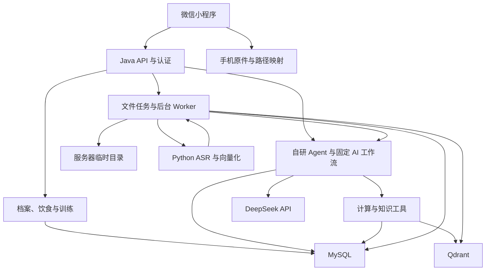
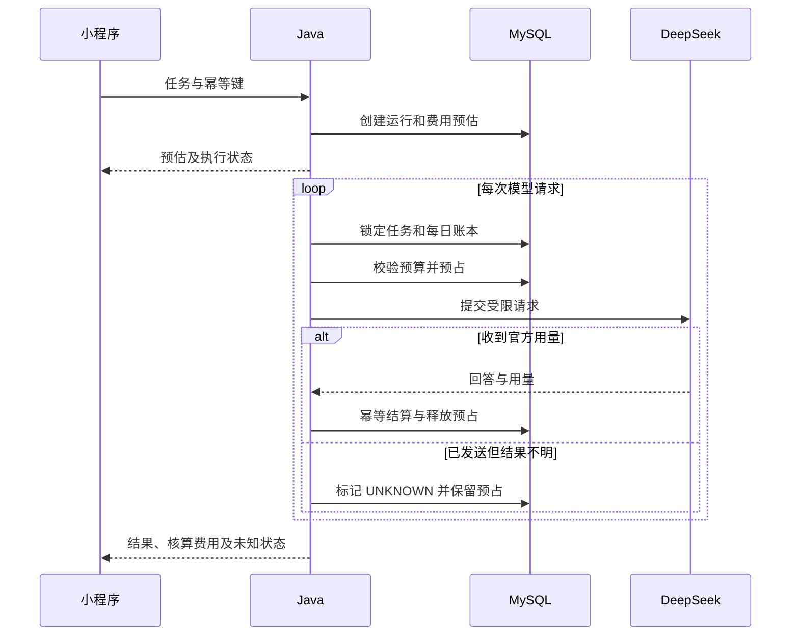

# 智能健康训练智能体小程序：项目大纲与架构

版本：v1.0。需求确认与来源核查日期：2026-10-12。项目简称：FitAgent。

这是一套可开始实施的设计方案与数据库初始化脚本，尚未实现小程序和后端代码。先完成一个可用的日常闭环，再逐步加入资料与教学视频。项目重点是 Java 自研 Agent、可追溯的计算与知识回答、用户自带模型 Key，以及有预算控制的多次工具调用。

## 1. 已确认的项目边界

| 项目 | 最终决定 |
|---|---|
| 客户端 | 微信小程序；uni-app + Vue 3 + TypeScript |
| 用户记录 | 体重、饮食、训练计划、实际训练及可选恢复感受 |
| AI 教练 | 用户向供应商充值，填写自己的 API Key；查询余额、展示任务预估和核算费用 |
| 首版供应商 | DeepSeek；统一接口预留其他供应商 |
| Agent | Java 自研；模型适配、工具注册、执行循环、上下文、预算、轨迹自行实现 |
| 主后端 | Java 21 + Spring Boot；模块化单体 |
| 辅助服务 | Python + FastAPI；负责本地语音转写与文本向量化 |
| 首版运行环境 | 自己电脑开发与演示；优先 CPU 可运行的小型模型、单个视频任务并发 |
| 原始文件 | 手机保留；需要分析时上传服务器临时目录 |
| 服务器长期数据 | 业务记录、文字转写、结构化分析、知识片段、用量与价格快照 |
| 文件清理 | 完成后清理原件、音轨、抽帧、上传分块；失败或取消任务按 TTL 清理 |
| 训练计划 | 手工录入、导入、AI 生成和修改；先草稿，用户确认后生效 |
| 视频 | 教学视频解析、步骤解释及时间点引用 |
| 预算 | 展示整次任务预估；单次和每日应用侧预算；超限不继续发起模型调用 |
| 登录与知识权限 | 默认微信登录；系统基础知识由管理员维护，用户上传资料默认私有 |
| 首版产品人群 | 普通成年健身用户，支持减脂、增肌、维持；自动公式先使用 19–59 岁常规健康人群规则 |

“原始文件主要保存在手机”不等于业务记录只存在手机。饮食条目、训练记录、转写和分析结果需要保存到服务器 MySQL，才能让 Agent 查历史并支持后台任务。首版不接 OSS，也不把原始视频长期放在服务器。

## 2. 核心用户闭环

用户建立身体与训练背景，记录饮食和训练；系统按来源和规则计算指标。用户可询问“今天完成得怎么样”，Agent 查询本人数据、调用计算工具及知识检索，给出带依据的回答。用户对食物分量、导入结果和计划草稿进行确认，形成后续分析可用的正式记录。

| 功能模块 | 首版行为 | 数据与结果 |
|---|---|---|
| 档案与目标 | 身高、体重、目标、器械、时间及经验；未知参数允许留空 | 不补造年龄、性别、重量；缺失参数阻止对应公式 |
| 饮食 | 拍照识别、文字录入、确认做法与克重、修正识别结果 | 正式记录只计 CONFIRMED；未知热量不是零 |
| 训练 | 每周计划模板、逐次训练、逐组次数与外部负重 | 计划与执行分开；保留对应计划版本 |
| AI 教练 | 问知识、查记录、解释当天和近期表现 | 数字来自计算工具，引用来自已验证检索结果 |
| 资料 | 文本、PDF、截图及教学视频 | 解析文本、文档页码、视频时间段；私有检索 |
| 日报和周报 | 基础统计免费刷新；用户主动生成 AI 讲解 | 保存输入数据修订号、规则版本、缺失项和引用 |
| 模型与费用 | 设置 Key、测试连接、刷新余额、设置预算、查看账单 | 不做小程序充值钱包；供应商余额与本应用费用分开 |

首版个人训练视频的姿态评分、真实时间动作纠正和器械自动连接不在本次开发范围内。教学视频解释不能被称为个人动作检测结果。

## 3. 小程序页面与操作入口

底部五个入口：今日、记录、AI 教练、资料、我的。

| 入口 | 子页面和内容 | 主要操作 |
|---|---|---|
| 今日 | 今天已记录摄入、运动估算、计划与最近体重 | 去记录；查看分析；主动生成 AI 日报 |
| 记录 | 饮食、训练、身体、每日记录完整性 | 拍饮食；记训练；记体重 |
| 训练计划子页 | 当前计划、版本历史、草稿 | 手工建立；导入；AI 生成；比较草稿；确认生效 |
| AI 教练 | 会话列表、聊天、工具运行状态、证据卡、费用 | 提问；停止任务；进入计划草稿或引用资料 |
| 资料 | 我的资料、解析任务、转写、教学步骤 | 上传解析；查看时间点；重新关联本机原件 |
| 我的 | 档案与目标、模型设置、预算、调用记录、本地文件 | 设置 Key；看余额；改预算；清理本机文件 |

单个页面保留一个主要按钮。导入、生成、编辑等操作在各自子页完成。AI 的“建议修改计划”返回草稿卡片，点击后进入计划确认页。

费用显示区分“发送前预计”“本次已核算”“存在用量不明”“供应商账户余额，更新于……”；低于显示精度的金额显示“低于 0.0001 元”，不能一律显示 0.00 元。

## 4. 技术选型

| 组件 | 方案 | 选择原因 |
|---|---|---|
| 小程序 | uni-app、Vue 3、TypeScript、Pinia、uni-ui | 延续 Vue 学习；提供本机媒体与微信能力入口 |
| Java 业务 | Java 21、Spring Boot、Bean Validation、MyBatis-Plus、Flyway | 普通后端开发与版本化数据库迁移 |
| 认证 | 微信 code2Session + 应用登录令牌；可用 Spring Security 实现认证与角色校验 | 用户身份由后端核实，服务层统一使用认证上下文 |
| 模型 HTTP | JDK HttpClient 或 OkHttp，Jackson | 自己实现请求、流事件、工具调用消息及用量解析 |
| Agent | 自研独立包 `agent-core` | 不使用 LangChain4j、Spring AI 或 LangGraph 做执行核心 |
| 数据 | MySQL 8.4 | 业务、草稿、版本、费用账本与任务状态的权威存储 |
| 缓存 | Redis；早期可以只缓存会话和限流 | 预算账本以 MySQL 为准，不把 Redis 作为费用唯一来源 |
| 向量检索 | Qdrant 本地容器 | 保存有权限过滤的知识向量；内容和状态仍回查 MySQL |
| Python | FastAPI + faster-whisper + Sentence-Transformers | 音频转写和本地 Embedding；不承担 Agent 编排 |
| Embedding | `BAAI/bge-small-zh-v1.5`，锁定模型 revision | 首版中文资料优先；模型卡给出 512 维，启动后再次断言实际维度 |
| 视频工具 | ffprobe + FFmpeg | 获取真实时长，解码音频与帧；Java ProcessBuilder 或 Python 参数数组调用 |
| 文档解析 | Apache PDFBox；需要 Office 时再加入 Apache Tika | 普通 PDF 提取文字；扫描页需要视觉识别，不假设文本提取能读扫描件 |
| 通信 | 普通 HTTP + 小程序 WebSocket；Java 到模型读取供应商 SSE | 不在小程序中假设存在浏览器 EventSource |
| 本地启动 | Docker Compose 启动 MySQL/Redis/Qdrant；Java/Python 可在 IDE 启动 | 降低调试成本；临时媒体目录单独挂载 |

Spring Boot 等具体依赖版本在建立项目时按 Java 21 兼容性锁定，并保存依赖文件。这里没有提供可运行工程，因此不把未建立的版本组合标记为已测试。

DeepSeek 当前文档支持图片输入的模型是 `deepseek-flash`，`deepseek-v4-pro` 为文本模型。首版默认 Flash 处理对话与图片，Pro 作为用户可选文本模型；选择不支持图片的型号时必须明确提示，不得悄悄换到另一把供应商 Key。来源：[A1]。

本地 ASR、Embedding 没有额外供应商 Token 账单，但消耗你的电脑资源。DeepSeek 适配器不假设具备完整视频音轨转写或 Embedding 接口；首版视频使用“本地转写 + 抽帧图片理解”，不是直接提交整段视频让模型自动完成所有工作。

## 5. 整体架构

Python 不直接读取模型 Key，不处理用户登录。Java 创建受控内部任务，将临时任务目录或受限任务标识交给 Python。内部服务只绑定本机/容器内网络，访问需要内部服务令牌。

| Java 模块 | 职责 | 主要数据 |
|---|---|---|
| identity | 微信登录、用户上下文、角色 | user_account |
| profile | 档案、目标、测量、记录完整性 | user_profile、user_goal、body_measurement、daily_checkin |
| nutrition | 食物匹配、分量、确认与营养计算 | food_reference、meal_record、meal_item |
| training | 计划版本、每日模板、训练与逐组记录 | exercise_reference、training_plan、workout_* |
| calculation | 纯计算函数、适用范围、规则快照 | calculation_rule、met_activity |
| model-access | 供应商白名单、加密凭据、余额与能力 | model_provider、model_catalog、model_credential、provider_balance_snapshot |
| billing | 用量、价格版本、预算预占与结算 | model_price、budget_*、model_call |
| agent-core | 模型调用循环、工具注册、上下文及轨迹 | agent_run、agent_step、chat_* |
| media | 手机逻辑 ID、临时上传、清理 | media_asset |
| jobs | 后台租约、阶段进度、恢复、结果 | processing_job |
| knowledge | 文档、片段、私有检索、索引事件 | knowledge_document、knowledge_chunk、outbox_event |
| report | 可重复计算的日报、周报 | analysis_report |

## 6. Java 自研 Agent 框架

### 6.1 框架组件

| 组件 | 自己实现的内容 |
|---|---|
| ModelClient | 统一请求、响应、消息和流事件；DeepSeekAdapter 转为官方格式 |
| ModelRouter | 按文本/图片/工具/JSON 能力选择用户已配置的模型 |
| CredentialResolver | 在发出 HTTP 时才解密 Key；不把 Key 放进 AgentContext 或 Prompt |
| ToolRegistry | 注册工具名、说明、DTO 和 JSON Schema；工具必须在白名单中 |
| ToolExecutor | Jackson 严格解析、拒绝未知字段、Bean Validation、权限、超时、限长结果 |
| AgentContext | 不可变 userId、runId、权限、数据修订号和预算引用；异步线程显式传递 |
| ContextManager | 当前问题、必要档案、历史摘要和有限最近消息；过长结果裁剪 |
| AgentRunner | 调用模型、判断 tool_calls、执行工具、追加工具结果、继续模型调用 |
| BudgetGate | 每次远程模型请求前进行预占；完成后幂等结算 |
| TraceRecorder | 记录调用、工具名、合法参数、证据摘要、错误和耗时 |
| CancellationToken | 客户端停止后禁止启动新步骤；尽力终止已有 HTTP 请求 |

普通 Spring、HTTP 和 JSON 库仍可使用。自研重点是执行机制，不是重新实现网络协议、加密算法或数据库连接池。

### 6.2 执行顺序

1. 校验登录、本人凭据、模型能力和当前数据。
2. 根据客户端幂等键创建一次 agent_run；重复请求返回同一任务。
3. 组装必要上下文与工具描述，显示整次任务的预估费用。
4. 在每次模型请求前检查单次预算、当天预算、轮数、上下文和输出上限。
5. 将本次调用记录为 PREPARED，短事务完成预算预占，再发 HTTP。
6. 返回工具调用时，先完整组装流中的参数 JSON，再解析、校验和执行；不能执行半段参数。
7. 将 assistant 工具声明与每个 tool_call_id 对应的工具结果追加到会话消息。
8. 需要继续模型调用时重新过预算关口。预算不足就保留已完成结果并结束任务。
9. 最终回答附工具产生的指标和有效引用；不能从模型文字提取一个新数字覆盖计算工具结果。
10. 汇总所有模型调用费用，刷新余额快照和任务状态。

工具消息按供应商协议成组维护，不能在裁剪历史时留下没有对应声明的工具结果。模型调用与工具循环设独立上限；视频固定工作流可有多段模型调用，但仍计入同一完整任务预算。

### 6.3 首版工具清单

| 工具 | 输入 | 输出与限制 |
|---|---|---|
| get_profile | 无用户 ID 参数 | 本人必要档案、目标和缺失项 |
| get_records | 日期范围、记录种类 | 本人有限范围记录；默认最多 31 天，这是工程限制 |
| get_training_plan | 日期或本人计划逻辑 ID | 指定计划版本、日模板和动作 |
| calculate_day_metrics | 业务日期 | 结构化指标、规则版本、范围及数据完整性 |
| search_knowledge | 问题、可选本人资料 ID | 系统及本人资料片段，页码/时间点/来源等级 |
| create_plan_draft | 经校验的计划结构 | 保存本人 DRAFT，不激活 |
| revise_plan_draft | 基础计划 ID、预期版本、修改结构 | 创建新版本，不覆盖旧计划 |
| get_video_guide | 本人任务或文档 ID | 已持久化步骤和时间点；缺原件不重新收费解析 |

模型没有执行任意 SQL、任意脚本、任意外部 URL 和激活计划的工具。用户 ID 在服务端绑定；模型传入的资料、任务或计划 ID 仍必须校验归属。

饮食识别、导入计划和教学视频采用固定工作流；聊天教练使用工具循环。固定工作流也通过同一个 ModelClient、BudgetGate 和用量账本收费，不出现独立绕过预算的视觉接口。

### 6.4 输出契约

计算工具统一返回：`metric_code / value或range / unit / rule_version / input_snapshot / evidence_refs / missing_fields / estimate_kind`。数据不足时 value 为 null，列出缺失原因。

食物识别返回 `foods[]`，每项包含候选名称、画面依据、可能做法、分量假设和待补充问题；模型给的食物名称不是已确认的食物库 ID。后端先匹配有来源条目，用户再确认。

教学视频返回 `segments[]`，每段包含 `start_ms/end_ms/title/steps/evidence_chunk_ids/limitations`。引用 ID 必须存在且属于当前用户允许访问的资料；模型自由生成的新引用不能展示为来源。

计划输出先严格校验动作、组数、时长、器械与档案限制，再成为草稿。无法匹配动作字典时提示用户处理，不能自动往系统字典塞入模型输出。

## 7. API Key、余额与费用

### 7.1 凭据生命周期

用户在模型设置页输入自己的 DeepSeek Key，经 HTTPS 或本地开发受控连接发给 Java。Java 验证后使用成熟 AES-GCM 实现加密保存。每次加密使用新的 12 字节随机 nonce；认证附加数据绑定 userId/providerId/credentialVersion。主密钥保存在环境变量或受保护的本机密钥配置，不入库、不入 Git。

页面只接收凭据 ID、标签、状态和脱敏尾部。日志屏蔽 Authorization，模型请求、工具结果、执行轨迹和 Python 服务都不能收到 Key。HMAC 指纹使用独立受保护密钥或规范密钥派生，与加密密钥分开管理。[A9]

更换 Key 递增凭据版本，历史账本保留旧版本号。撤销时清除密文并阻止后续调用，后台任务进入 WAITING_CREDENTIAL。撤销无法追溯取消已经被供应商接收的调用。主加密密钥丢失将无法解密原 Key，需要用户重新配置。

### 7.2 余额

DeepSeekAdapter 请求官方 `GET /user/balance`，保存每个币种的 total/granted/topped_up 及查询时间。[A2] 这是供应商账户级余额，可能受本项目之外的调用影响，也不是一个 API Key 独享的额度。

余额查询失败时显示上次成功值并标记过期，不写成 0。首次查询失败则显示“暂无法获取”。首版建议缓存 60 秒并允许用户主动刷新；该时间是工程设置。

### 7.3 费用核算

按每次调用的官方用量与同币种价格计算：

`C = (输入缓存命中Token × 命中价 + 输入未命中Token × 未命中价 + 输出Token × 输出价) / 1,000,000`

一次完整任务的费用是所有已知调用费用之和，包括视觉、计划生成、文档或视频各段分析。reasoning_tokens 是输出细分信息，不能在 completion_tokens 之外再加一次。[A1][A3]

价格表保留版本、币种、档位和来源核查日期。SQL 给出 2026-10-12 官方人民币报价快照。预占采用高峰档、不假定输入缓存命中。调用后在档位已确定时按相应档结算；节假日或跨档归属无法确定时显示保守核算，不称为准确供应商扣费。官方结算记录是最终账单依据。

若供应商余额返回 USD、应用预算按 CNY，就分开展示两个币种，不自动使用猜测汇率换算或比较。更换币种必须选择有官方原生报价的价格版本，或者以后另行设计明确的汇率规则。

### 7.4 并发预算与未知费用

预占检查包含已结算、正在执行的预占和未知结果预占，避免两个并发提问都花同一笔日预算。数据库事务只覆盖检查与记账，不能在行锁期间等待远程 HTTP。

跨北京时间午夜的长任务按每次调用开始日分配日账本。整次任务预算仍覆盖所有日期的调用。相同 reservation 只结算一次，避免重复流事件或回调多记费用。

发送前 Token 和输出量不完全可知，应用预算是保守预占加逐轮停止机制，不是供应商账户硬额度。若已发出的调用高于预估，记录超支并停止后续请求；不能撤销供应商已发生的费用。

连接中断后缺少 usage，金额记为未确定，保留预占，禁止该段无条件自动重发。客户端停止也不把费用记成 0。不使用前后余额之差冒充单次费用。用户主动重试时提示可能再次计费。

## 8. 手机文件与临时上传

### 8.1 两种本地存储的分工

| 位置 | 保存内容 | 生命周期 |
|---|---|---|
| 手机文件系统 | 用户选择保存的原图片、视频、PDF | 本机保留，清理缓存/重新安装/换设备可能失去访问 |
| 手机轻量存储 | asset_uuid 到本机路径的映射、摘要、文件名、可用状态 | 每次查看前检查路径是否仍可读；不保存大型 base64 |
| 服务器临时目录 | 上传分块、合并原件、音轨、抽帧 | 只供当前解析；完成后清理，未完成任务按 TTL 清理 |
| MySQL/Qdrant | 元数据、转写、结构化结果、可引用片段、向量 | 用户可查历史和删除资料 |

手机路径如 wxfile:// 不是远程可访问地址，也不作为服务器永久 URL。`media_asset.asset_uuid` 是统一逻辑标识，实际手机路径留在设备。小程序文件接口与轻量键值缓存有不同限制；实现时按微信当前文档和基础库验证额度，不承诺本机可无限保留视频。[A4]

视频入口支持“重新选择原件”；核对 SHA-256 后重新建立本机映射并跳转时间点。内容摘要不同则作为新文件，不能直接复用旧视频时间轴。换设备时仍可查看解析文字，但播放原片段需要原件。

### 8.2 上传与清理策略

首版工程限制建议：图片压缩后不超过 5 MiB；文档不超过 20 MiB；教学视频不超过 5 分钟、50 MiB。这些是项目资源控制参数，不是微信或模型官方限制。音轨/帧参数通过配置调整并在电脑上测时。

大文件使用固定大小分块，例如 4 MiB；每块是普通上传请求，合并后服务端核对总字节数与摘要。首版本机单实例可在临时目录保存分块 manifest；media_asset 记录上传状态，任务仅在完整原件核验后创建。请求必须验证本人、块序号、数量与尺寸，不能把原始文件名拼入磁盘路径。

服务器目录以自己生成的用户/任务标识分配；保存相对路径。FFmpeg 调用使用参数数组，不拼接 shell 命令。清理仅在受控临时根目录内执行，不能跟随用户可控符号链接。

解析结果提交成功且无其他活动任务依赖原件时，写 CLEAN_TEMP_MEDIA 事件并清理全部中间媒体，保留逻辑元数据。取消、失败、未合并上传默认最多保留 24 小时供有限重试，这是工程 TTL；到期即清理，后台重启后也扫描过期项。

优先通过图片 bytes/base64 调用模型，不使用供应商 Files API 建立长期原件副本。图片及相关文字仍会发送给用户所选供应商，小程序上传页明确说明处理范围；本项目清理本地临时文件不等于控制供应商自己的数据保留政策。

## 9. 饮食识别与训练计划工作流

### 9.1 饮食识别

1. 用户拍照，保留可读本机文件并创建逻辑 ID。
2. 展示预估费用，用户启动识别。
3. Java 校验上传内容，创建 agent_run 与 processing_job。
4. Flash 输出候选食物、可观察内容、做法及缺失分量，不把视觉估计当称重。
5. 后端匹配有来源的 food_reference；未匹配食物允许用户选择相近有来源条目或手工录入标签数据，并标注来源。
6. 页面询问克数/份量、配料或用油等必要信息。分量只有“小碗”而无有依据克重时保留未知，不强造热量。
7. 形成 meal_record DRAFT 与 meal_item；用户纠正后由后端重新计算。
8. 确认后置 CONFIRMED，保留营养密度和来源快照、递增数据修订号，清理临时原图。

食品营养标签优先按实际规格换算；kJ 转 kcal 使用统一转换。食物库来源、生熟、做法必须可追溯。SQL 没有塞入虚构营养种子，数据导入是 P1 的独立任务。

### 9.2 训练计划

手工录入通过动作字典建立每周模板；导入支持文本、图片/PDF 的计划提取，结构化后仍让用户核对。AI 生成先读取目标、可用时间、器械和训练经验；必要参数缺失时追问。

生成或修改创建 DRAFT。修改同一计划生成新 revision，记录 base_plan_id。用户确认时校验乐观锁，事务内将旧 ACTIVE 归档，再激活新版本；保留旧内容。激活与停用属于生命周期变化，不覆盖历史动作和实际记录。

首版采用每周星期模板，starts_on/ends_on 定义执行周期；未来如需完整周期化训练，再增加阶段模板。实际训练记录链接发生时的计划日与动作 ID。AI 不自行把新草稿设为 ACTIVE。

训练分析分别显示计划组数完成度、次数情况、时长完成度及相同动作外部负重变化；不把这些工程指标写成生理训练效果或医学动作评分。

## 10. 资料与教学视频

### 10.1 文本与 PDF

文本/PDF 解析保留页码，扫描页才调用视觉模型。创建 PRIVATE 文档；按自然段和章节切片，较长段再按当前 Embedding 模型输入上限分段。每片段保存内容摘要、文档版本、来源等级。

Python 生成本地向量，Qdrant 保存 point UUID 和可信后端生成的 payload：文档 ID、版本、scope、owner_user_id、chunk ID、时间点/页码、模型 revision。不要把整篇资料装进每次 Prompt。

### 10.2 教学视频

| 阶段 | 实现 | 持久化结果 |
|---|---|---|
| 元信息 | ffprobe 确认时长和编码 | 时长、摘要、任务状态 |
| 语音 | 提取音轨；faster-whisper 多语言小模型，首版 CPU/int8、一个任务 | 带开始/结束时间的 ASR 文字 |
| 画面 | 按时间间隔及场景补充抽帧；给 Flash 同组图片及真实时间戳 | 有时间点的视觉观察文字 |
| 对齐 | 分段对齐转写与画面观察 | SOURCE/ASR/VISUAL/COMBINED 类型片段 |
| 讲解 | 结合片段和检索到的基础知识生成教学步骤 | 动作名称、准备、步骤、注意点、来源及时间点 |
| 索引 | 本地 Embedding + Qdrant | 可继续问答的文档片段 |
| 清理 | 结果完成持久化后执行 | 无服务器长期视频、音轨或图片帧 |

ASR 的时间点是模型转写估计；抽帧时间来自解码时间轴。教程讲解仅涵盖转写/已抽样画面支持的内容，不能声称逐帧核查整段动作。识别听不清或看不清时标注，不补造动作细节。[A5]

首版建议按 5 秒抽样、每任务最多 60 帧，按片段分批并结合预算决定是否处理。参数是工程起点。未处理部分在结果中标记为未分析，不能在预算中断后展示“全部解析完成”。

每阶段结果 checkpoint 持久化，已成功且结算的模型调用不重复执行。Worker 使用数据库租约领取任务，失去租约后停止新步骤；断点缺原件时进入 WAITING_INPUT，提示重新上传同一原件。单机并发先限制为 1 个视频任务，不给未测过的吞吐或准确率承诺。

### 10.3 有权限的 RAG

检索条件为 SYSTEM 或 owner_user_id=当前用户，且文档未删除、版本有效。先过滤 Qdrant，再按命中 ID 回查 MySQL 权限/状态/版本，丢弃过期或越权命中。[A8]

小型首版先做密集向量检索与来源排序，检索条数和分数阈值通过小样例校准，不把相似度当回答正确率。需要时才加入重排和关键词融合。

系统维护资料优先；用户上传视频不是经过科学验证的结论。视频说法与基础知识冲突时区分来源并说明不能直接采纳，不把上传内容中的指令当作系统命令。

删除文档时先在 MySQL 标 DELETED、写向量删除事件，立即停止回答引用；后续清理所有模型集合中的相关 point。不要等异步删完向量才取消访问。

## 11. 计算与报告边界

完整规则、算例和验收输入见《计算规则与来源.md》。所有计算由 Java 纯函数执行，规则版本写入快照，LLM 不提供新的系数。

首页“运动期间能耗估算”与“全天能耗参考范围”分别展示。全天参考使用 BMR 的来源方法和长期 PAL 范围，不从今天训练分钟数假装测到准确全天消耗。Mifflin–St Jeor 单独用于 REE 展示，不与 FAO BMR×PAL 无说明混用。

饮食缺一餐时展示“已记录摄入”；daily_checkin 由用户明确确认记录完整性。只有记录完整且各条能计算时，才展示摄入与全天参考范围的差额，仍标注估算，不能声称实际燃脂数量。

报告保存各指标输入、来源、规则版本与缺失项。饮食/训练/目标改变后递增数据修订号，旧报告显示过期。基础统计重算不调用模型；用户点击重新生成 AI 解读时再展示预估并计费。

对超出规则适用范围、用户声明有需专业指导的状况或需要疾病/疼痛诊断的请求，保持记录与一般知识解释功能，停止自动给个体数值训练或饮食处方。

## 12. API 接口清单

| 模块 | 示例接口 | 要求 |
|---|---|---|
| 登录 | POST /api/auth/wechat-login | 前端 code 由后端向微信核验；开发 mock 仅在 dev profile |
| 档案 | GET/PUT /api/me/profile；GET/POST /api/me/goals | owner 来自当前登录；带 lock_version 更新 |
| 身体 | GET/POST /api/body-records | 客户端 UUID 去重；日期与单位校验 |
| 每日状态 | PUT /api/checkins/{date} | 明确记录完整性及可选恢复信息 |
| 食物 | GET /api/foods/search | 只返回有效来源条目 |
| 饮食 | POST/PUT /api/meals；POST /api/meals/{id}/confirm | 服务器计算；草稿不计入正式汇总 |
| 计划 | POST /api/plans；POST /api/plans/{id}/revisions；POST /api/plans/{id}/activate | 草稿、版本、确认事务 |
| 训练 | POST/PUT /api/workouts；POST /api/workouts/{id}/entries | 校验本人及计划对应关系 |
| 媒体 | POST /api/media/register；POST /api/media/{id}/chunks；POST /api/media/{id}/complete | 本机逻辑 ID、分块尺寸、摘要、合并核验 |
| 文件任务 | POST /api/jobs；GET /api/jobs/{id}；POST /api/jobs/{id}/cancel | 幂等、预算、租约与进度；仅本人 |
| 资料 | GET /api/documents；GET/DELETE /api/documents/{id} | 状态回查、私有权限、向量删除事件 |
| 教学 | GET /api/documents/{id}/guide | 返回结果与时间点，无已清理原件 URL |
| 凭据 | PUT /api/model-credentials/deepseek；DELETE /api/model-credentials/deepseek | 写入/撤销；读取接口绝不返回完整 Key |
| 余额 | GET /api/model-credentials/deepseek/balance | 值、币种、查询时间与 stale 标志 |
| 预算 | GET/PUT /api/budgets/deepseek | 同币种；单次与每日限制 |
| 对话 | POST /api/conversations；POST /api/conversations/{id}/runs | 客户端幂等键；关联当前用户 |
| 流式 | /api/ws/agent | 登录后订阅本人 runId；不在 URL 上传 Key |
| 任务 | GET /api/runs/{id}；POST /api/runs/{id}/cancel | 重连取状态，停止下一次模型调用 |
| 费用 | GET /api/usage/tasks；GET /api/usage/daily | 分已知核算和未确定金额；分页 |
| 统计 | GET /api/metrics/daily；POST /api/reports | 免费确定性统计；AI 解读单独任务 |

API 更新使用版本号，越权 ID 返回统一错误；分页与日期跨度有上限。模型日志使用脱敏错误码，不把供应商返回的完整请求内容直传给客户端。

## 13. 本地工程组织与演示

| 目录/包 | 内容 |
|---|---|
| miniapp | uni-app 页面、业务 API、WebSocket、本机媒体映射 |
| backend/agent-core | 独立执行器、模型和工具契约、上下文、轨迹接口 |
| backend/app | Spring Boot 启动、各业务模块、适配器和数据库实现 |
| media-worker | Python ASR、Embedding、受控内部 API |
| infra | 本地 Compose、临时目录与数据库卷配置 |
| docs | 本套设计、规则、API 契约、阶段验收 |

本机数据持久化目录与临时上传目录分开。MySQL/Qdrant 为持久化卷；媒体任务工作目录为可自动清理的临时卷；模型权重缓存单独保留，避免每次转写重新下载。

微信开发者工具访问电脑后端与手机真机访问电脑后端是两种环境。真机上的 localhost 指手机；要使用可达的电脑地址并按微信调试要求配置。未来发布到体验版或正式环境需有效 HTTPS/WSS 和配置合法域名，本机开发地址不能直接作为长期线上部署方案。

演示顺序：登录→配置本人 Key→看余额和预算→录入身体与目标→拍饮食并纠正分量→记录训练→问“今天完成得怎样”→查看指标与来源→生成计划草稿并确认→解析短教学视频→点击本机时间点→查看整次任务用量及临时文件清理状态。

## 14. 开发阶段与验收

| 阶段 | 实施顺序 | 完成标准 |
|---|---|---|
| P1 基础业务 | 登录、档案、目标、身体、食物来源、饮食、动作字典、计划及训练 | 无 AI 也能录入、修改、确认和查看历史；公式有来源与缺失策略 |
| P2 Agent 和费用 | Key 加密、官方余额、价格、用量、并发预算、聊天工具、拍照识餐、计划草稿、报告 | 一次任务的每次调用有记录；并发不绕过预算；未知用量不写零；计算来自工具 |
| P3 资料和视频 | 分块上传、数据库 Worker、文本/PDF、ASR、抽帧、RAG、时间点、清理与索引事件 | 断点可恢复；私有检索不越权；结果有证据；原件清理后仍能问答 |

完整 SQL 包含 36 张表、514 个字段。它按外键依赖创建完整结构，开发任务仍按 P1/P2/P3推进，不要求一次完成所有模块。

| 必须验证的行为 | 验收方式 |
|---|---|
| 用户隔离 | A 的登录上下文读取 B 的计划、任务、余额、文档均失败；向量命中也不能越权 |
| 草稿确认 | AI 生成和导入不能直接覆盖 ACTIVE；并发激活只留下一个 ACTIVE |
| 公式 | 核对规则文档算例、生日/年龄分组、kg/g/cm/m、秒/小时转换与 NULL 输入 |
| 饮食完整性 | 漏餐、分量不明、营养源未匹配时不显示准确全天摄入或缺口 |
| 费用 | 重复流事件不重复结算；推理 Token 不重复计费；多个调用合并显示 |
| 预算 | 两个并发任务、午夜跨日、取消、已发送超时、用量缺失都维护预占 |
| 重试 | 网络结果不明的付费步骤不无条件重发；确认完成的步骤断点恢复不再次调用 |
| 文件 | 合并大小/摘要错误失败；进程重启仍清理过期原件、音轨、帧和分块 |
| 资料删除 | 先立刻禁止检索，再异步清理 Qdrant；旧版本向量不能继续被引用 |
| 视频引用 | 每个引用可回查片段，时间段不超过原片长度；本机原件缺失时提示重新关联 |

拍照识别使用有人工食物名称标注及称重/标签的数据样例评估，分别报告名称识别与营养估算误差。ASR/时间点用人工核对的短视频样例检查；RAG 用有来源答案的问题检查引用支持性。初期可各整理 20 个小样例作为回归集，这只是开发起点，不宣称评测规模充分或准确率达到某个数值。

## 15. 面试时可以展示的真实工程点

| 主题 | 应拿出的证据 |
|---|---|
| 自研 Agent | 一次多工具运行轨迹、参数错误处理、终止条件和上下文裁剪 |
| 多模态 | 食物识别到用户纠正、营养条目匹配与代码计算的完整记录 |
| 费用 | Token 用量原始对象、当时价格版本、逐调用记录和任务汇总 |
| 并发后端 | 预算行锁和幂等、任务租约、计划版本事务 |
| RAG | 来源及片段 ID、权限过滤、删除后不能检索的演示 |
| 媒体处理 | 转写、抽帧时间点、阶段恢复和临时文件清理 |

完成并验证后再写进简历；不要把设计方案写成已实现性能或实际用户规模。

## 16. 配套交付与检查边界

阅读顺序：《项目大纲与架构.md》→《计算规则与来源.md》→《数据库设计与字段字典.md》→`schema.sql`。

已完成字段/索引/外键类型及依赖顺序的静态一致性检查。交付环境没有 MySQL 服务，未执行真实 MySQL 导入，也未调用用户的付费 Key。SQL 是初始化脚本，导入和并发行为需要在你的本机工程完成验证。

## 17. 官方与原始来源

- [A1] [DeepSeek 模型与价格](https://api-docs.deepseek.com/zh-cn/quick_start/pricing/)：模型能力与当前人民币计价口径。
- [A2] [DeepSeek 查询余额](https://api-docs.deepseek.com/zh-cn/api/get-user-balance/)：账户余额字段。
- [A3] [DeepSeek Chat Completions](https://api-docs.deepseek.com/zh-cn/api/create-chat-completion/)：消息、工具、流式与 usage 契约。
- [A4] [uni-app 文件管理](https://uniapp.dcloud.net.cn/api/file/getFileSystemManager)、[微信文件系统](https://developers.weixin.qq.com/miniprogram/dev/framework/ability/file-system.html)：实现时以所用平台 API 为准。
- [A5] [faster-whisper 官方仓库](https://github.com/SYSTRAN/faster-whisper)：CPU/GPU 和转写时间点。
- [A6] [BGE-small-zh-v1.5 模型卡](https://huggingface.co/BAAI/bge-small-zh-v1.5)、[BGE 文档](https://bge-model.com/bge/bge_v1_v1.5.html)：模型维度及检索输入要求。
- [A7] [Sentence-Transformers 推理效率](https://www.sbert.net/docs/sentence_transformer/usage/efficiency.html)：CPU 与推理后端。
- [A8] [Qdrant Filtering](https://qdrant.tech/documentation/search/filtering/)：权限 payload 过滤。
- [A9] [NIST SP 800-38D](https://csrc.nist.gov/pubs/sp/800/38/d/final)：GCM 认证加密与 nonce 要求；调用成熟实现。
- [A10] [MySQL CHECK](https://dev.mysql.com/doc/refman/8.4/en/create-table-check-constraints.html)、[生成列](https://dev.mysql.com/doc/refman/8.4/en/create-table-generated-columns.html)：初始化脚本使用的约束机制。

健康计算的原始论文和来源汇编见《计算规则与来源.md》。微信官方文件系统页面在本次检索中未成功读取，因此未引用其容量数字；文件操作能力同时核对了 DCloud 文档，具体额度在本机小程序开发时验证。
